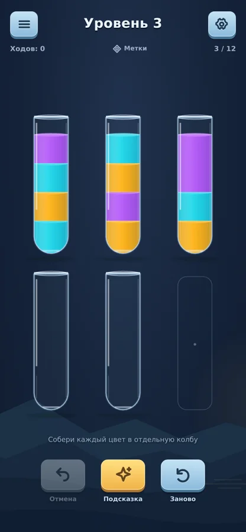
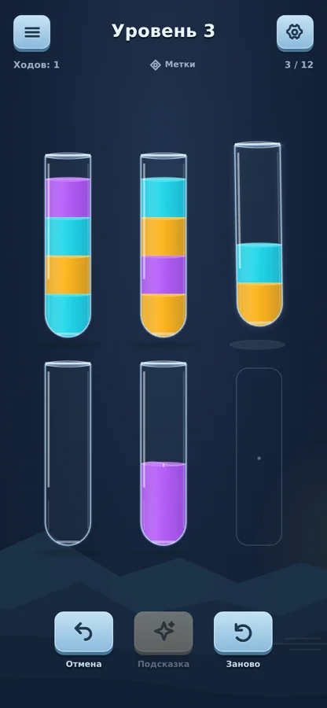
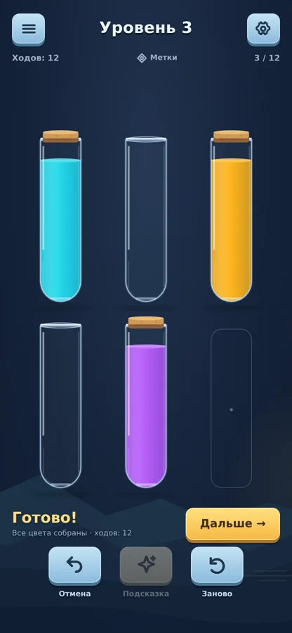
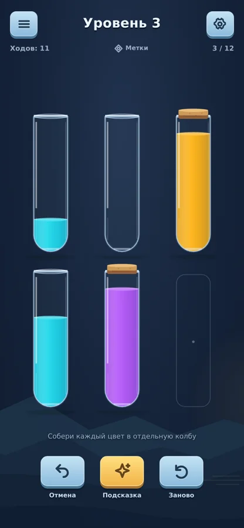
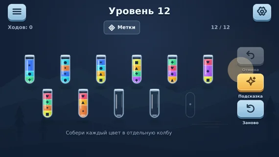

# Переливы 0.4 — игровое оформление

24 октября 2026. Замена отклонённого владельцем оформления 0.3. Референс композиции и управления — Water Color Sort (Vnstart); предметное стекло и завершение пробкой — Water Sort (Fantasy Games). Использованы собственные код, пиктограммы и векторный фон; изображения конкурентов не включены в приложение.

## Референсы и границы анализа

Просмотрены магазинные скриншоты шести конкурентов: Vnstart, Guru, Fantasy Games, IEC, Dark Halo / SortPuz, Grand Games / Magic Sort. Они показывают визуальные решения, но не подтверждают реальную скорость переливания, звук, UX всех меню или производительность устройств. Рекламные сцены с десятками бутылок не использовались как образец реальной плотности поля.

- [Vnstart: Water Color Sort](https://play.google.com/store/apps/details?id=com.vnstartllc.sort.water): компактные светло-голубые кнопки, простой номер уровня, тонкие вытянутые пробирки, тёмная основа.
- [Fantasy Games: Water Sort](https://play.google.com/store/apps/details?id=water.sort.puzzle.wood.color.sort.brain.train.test.watersort.ball.sort.logic.game): округлое стекло и предметное завершение колбы пробкой.
- [Guru](https://play.google.com/store/apps/details?id=water.sort.puzzle.game.color.sorting.free): читаемые слои и компактная панель; узор и фиолетовая тема не перенесены.
- [IEC](https://play.google.com/store/apps/details?id=com.gma.water.sort.puzzle), [SortPuz](https://play.google.com/store/apps/details?id=sortpuz.water.sort.puzzle.game), [Magic Sort](https://play.google.com/store/apps/details?id=com.grandgames.magicsort): полезны контраст, блики и состояния собранных бутылок; персонажи, события, магазины и перегруженные промосцены не входят в эту итерацию.

## Реализация

- Ночной синий фон, собственный векторный пейзаж у нижнего края. Светлая тема стала холодной голубой. Кремовая/зелёная палитра удалена.
- Пропорции колб около 1:3.5, полукруглое дно, выраженная горловина, базовый блик и толщина стекла. Плотные насыщенные жидкости.
- Компактная верхняя панель и небольшие кнопки инструментов с нижней гранью, более жирными пиктограммами и продавливанием. Подсказка выделена жёлтым.
- При завершении цвета пробка опускается с затухающим отскоком. После загрузки она остаётся у собранной пробирки. Пока идёт переливание, пробка не появляется; выбор собранной колбы открывает её для разрешённого правилами переноса.
- Undo пересобирает колбы по актуальному состоянию, снимая отменённую пробку. На финальном ходе повторно не празднуются уже собранные цвета.
- Сохранены динамическая струя, деформация поверхности, частицы, обратный ход и звуковые акценты версии 0.3. Новый звуковой пакет не создавался.
- Меню, настройки и итог используют ту же систему цветов/кнопок. Доступность закрытия в коротком альбоме сохранена.
- Старые сохранения без `artVersion` один раз переходят в новую ночную тему, сохраняя ходы и прогресс. После сохранения выбранная пользователем светлая тема сохраняется как обычно. Отдельная проверка покрывает этот переход.

## Проверка

- 15 unit/integration tests, включая 42000 промежуточных проверок границ перелива и сохранность прогресса при переходе темы.
- 9 браузерных сценариев: реальный ввод с DPR 3, подсказки, очередь, Undo/reload, победа/поворот, настройки, ошибка аудио.
- 30 захваченных кадров на девяти размерах в двух темах; необработанных JS-ошибок нет. [Матрица](polish-04/capture.json).
- `tools/capture-feel.mjs`: реальный production bundle, уровень 3 по witness, переливы, Undo, завершение и подсказка. Видео около 31 секунды, **без звука**; кадры не композились. [Данные записи](polish-04/recording.json).
- Физическое Android-устройство и субъективное прослушивание не проверялись. Видео браузера не заменяет телефонную приёмку.
- Android versionCode 4, versionName `0.4.0-night`, пакет `.preview3` и фиксированная тестовая подпись сохранены от 0.3. Обновление совместимо с 0.3 при совпадении сертификата, что дополнительно проверяется по собранному APK. Для 0.2 установка остаётся отдельной.

## Работающая сцена

