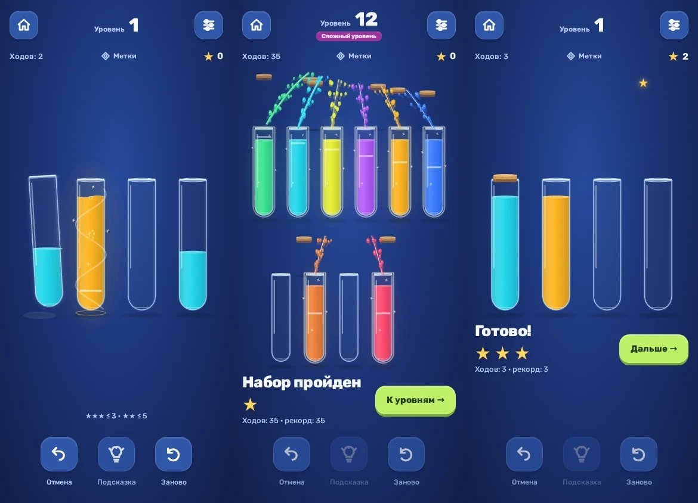

# 0.16 — связанный игровой цикл по разбору Magic Sort

28 октября 2026. База — 0.15, `be7950e2f1b8350cb342d8e79a20ce8cb66bbcbd`. Предшествующий [разбор записей](MAGIC_SORT_VIDEO_REVIEW_16.md) остаётся исследованием, этот документ описывает реализацию.

## Что изменилось

- В нормальном режиме подъём 125 мс, поток 145 + 42 × число слоёв мс, возврат 100 мс. Быстрый режим сохраняет множитель 0.7. Механика легальных ходов, геометрия объёма, однократное принятие очереди и порядок сохранения не менялись.
- Завершение цвета происходит на границе наполнения, пока источник возвращается. По колбе идёт блик, вокруг неё поднимается световая спираль, пробка появляется и садится. Звук воды относится к наполнению, отдельный настоящий cork — к посадке. Перенос уже собранного цвета не создаёт ещё одну награду. Повторное использование колбы отменяет старую посадку/звук над её пустым слотом.
- После последнего возврата сразу доступны результат и «Дальше». Через 220 мс начинают вылетать пробки, из собранных цветов выходят короткие сходящиеся фонтаны с каплями. Каждый цвет получает свой эффект. Это косметический выброс; собранное состояние жидкости сохраняется. Эффекты заканчиваются за ~1.7 с и никогда не блокируют следующую задачу.
- Звёзды результата появляются поочерёдно. Только улучшение общего результата летит к постоянному счётчику, с реакцией счётчика, звуком и мягким тактильным событием на каждое прибытие. Общий прогресс виден на поле и дома.
- Общий счётчик вычисляется из лучших сохранённых решений, а не хранится отдельной валютой. Повтор тех же трёх звёзд даёт +0; улучшение с одной до трёх даёт +2. Старые пройденные уровни без проверяемого маршрута сохраняют прежнюю одну звезду. Победный ход/рекорд сохраняется ДО косметики: «Дальше», фон, закрытие или перезагрузка ничего не теряют и ничего не начисляют повторно. Восстановленный результат отображается статично.
- Профили haptic: кнопки/выбор, принятие хода, завершение цвета, общий запуск фонтанов, отдельное прибытие награды. Нет отложенных вибрационных паттернов и догоняющего воспроизведения. Native View feedback соблюдает системную настройку; тумблер игры работает независимо от звука. На Android 34+ сбор награды использует очень мягкий `SEGMENT_FREQUENT_TICK`, на старых устройствах — `TEXT_HANDLE_MOVE`, до API 27 частый collection tick пропускается. Цвет/победа используют системный CONFIRM (с безопасным fallback); это не обещание одинаковой силы на всех моторах.
- Нынешние уровни 8 и 12 вручную отмечены как challenge: первый переход к шести цветам и финальная задача с восемью. Метка видна в домашнем меню/выборе уровней и на поле, с коротким вступлением. Разметка предварительная редакторская: человеческой статистики ошибок пока нет, оптимальная длина сама по себе не доказывает трудность. Множители наград не придуманы, пороги звёзд неизменны.
- Выбранная система A и четыре темы сохранены. Результат получил более крупные звёзды, а на маленьких экранах — компактную компоновку. Reduced motion убирает спираль, разлёт пробок, фонтаны, большую дугу/масштаб звёзд; остаются спокойный блик и короткое получение прогресса.

## Звук и происхождение

`complete`, `cork`, `victory` заменены; добавлен `collect`. Это записи воды, пробки бутылки и металлического контакта из CC0 Tinysized SFX, без tonal pluck в завершении цвета и победе. Пакет имеет 12 Vorbis-семплов. Исходные файлы, обработка, воспроизводимый генератор и хеши описаны в [AUDIO_CREDITS.md](AUDIO_CREDITS.md) и `public/audio/material-report.json`. Hint пока сохраняет прежний sampled pluck.

Сигналы проверены после декодирования фактического OGG: peak новых файлов < 0.73, RMS 0.051–0.101, длительность 0.187–0.897 с. Runtime по-прежнему ограничен четырьмя голосами, с тихим release при прерывании. Числа не доказывают приятность: живое прослушивание динамика/наушников и сила мотора здесь не проверены.

## Проверка

- Локальная сборка TypeScript/Vite и 30 core-тестов.
- Полный браузерный прогон: 94/94 до заключительной правки отмены старой пробки/синхронизации haptic; после неё — 16/16 целевых feel/reward, отдельный regression на немедленное использование собранной колбы и 95/95 в CI.
- Новые сценарии: сохранение до анимации; повтор без фарма; фон и «Дальше» отменяют будущие collection cues; reduced motion; challenge HUD на 320×480 и 568×320; завершение цвета при ещё летящем источнике. Существующие проверки покрывают Undo/очередь/рекламу/темы/ошибки записи/декодирование всех 12 семплов и лимит голосов.
- `tools/capture-feel-16.mjs` — запись production build с обычными часами, реальными кликами и валидными сохранениями из witness; никаких CSS-подмен и SDK-моков. `tools/capture-frames-16.mjs` — отдельные точные кадры того же renderer с управляемыми browser clock, чтобы кодирование PNG не сдвигало выбранную фазу.
- Реальный Android SDK rewarded и ощущение haptic на телефоне этим проходом не подтверждаются. Debug остаётся с демоблоком Яндекса, package/certificate совместимы с предыдущими preview.

## Границы пакета

Высокая бутылка, скрытые цвета, магазин, жизни и новая экономика сюда не входят. Конкурентные изображения/видео/звуки не добавлялись в игру. Большая бутылка остаётся отдельным следующим пакетом с изменением правил, решателя и расчёта звёзд. Одновременные независимые активные переливания не вводились: записи конкурента их достоверно не подтверждают, текущая очередь сохраняется.

## Кадры и нагрузка

[Обзор трёх фаз](audits/feel-16/preview.webp). Отдельные кадры и метаданные лежат в `docs/audits/feel-16`; `capture.json` фиксирует реальные размеры кнопки продолжения, происхождение кадров, хеши изображений и production bundle. При максимальном поле кнопка остаётся 48 px высотой на 320×480, 568×320 и 390×844.

`tools/benchmark-feel-16.mjs` измеряет CPU update реального dev renderer при последнем переливании и победе восьми цветов, DPR 2. [Данные](audits/feel-16/render.json): p95 победы 2.2 ms без throttling и 8.8 ms при ×4. Одновременно было не более 46 хранимых частиц и 9 burst-событий (восемь финальных + завершающийся последний цвет); короткие струи и их 22 капли на цвет вычисляются аналитически, без неограниченного накопления объектов. После хвоста действует прежний ранний выход/кеш спокойных колб. Это небольшой диагностический прогон, не телефонный FPS/GPU/battery benchmark и не гарантия слабых устройств.

## Собранный APK

- Игровой commit: `f8e65e927cca5b74563e5bf9c6ad00133a73211e`.
- [CI 40641711913](https://github.com/DanilaH/watery-water-sort/actions/runs/40641711913): 30 core, 95 browser, 24 независимые проверки оптимумов, build и assembleDebug — success.
- Manifest: `com.danilah.waterywatersort.preview3`, versionCode 16, `0.16.0-feel`.
- APK: 9 922 995 байт, SHA-256 `4b051d82734c27b4890e34b93259d4066c339459ec2a7fc62ff2189da032133b`.
- Проверены RSA/SHA-256 v2 signature и защищённые дайджесты по AOSP; копия с изменённым защищённым байтом отвергнута. Сертификат совпал с прежним публичным preview (`c429d185…62a373`). Это проверка v2, не заявление о тесте установки на реальном телефоне.
- Все 23 файла локального `dist` побайтно совпали с `assets/public` APK, в том числе 12 OGG, шрифт/лицензия и новый JS/CSS. ZIP CRC в порядке.
- Воспроизводимый ограниченный verifier: `python tools/verify-apk-16.py APK .` (Python + cryptography); [машинный отчёт](audits/feel-16/apk.json).
