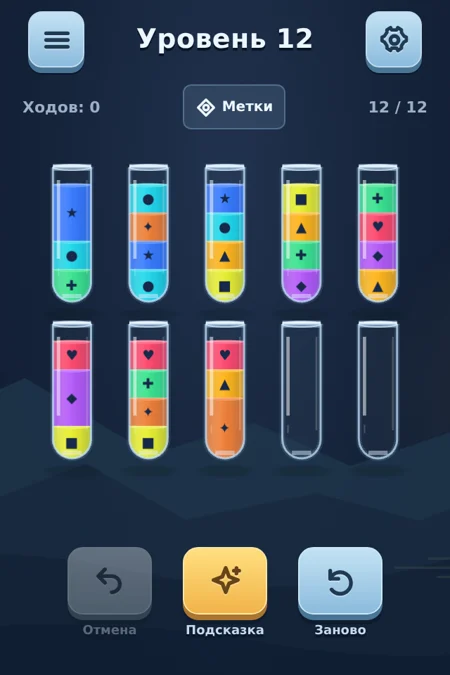
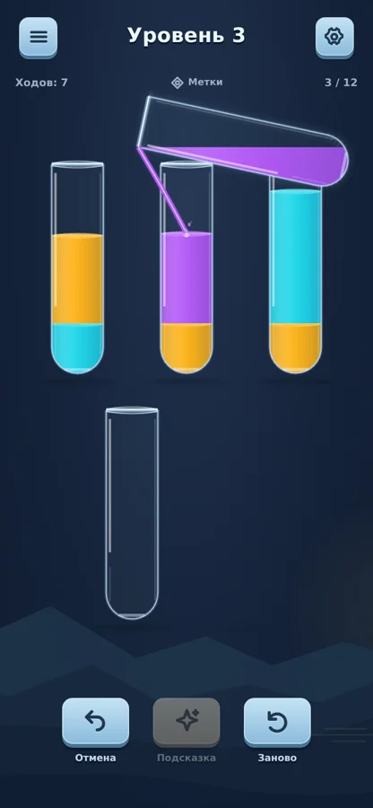
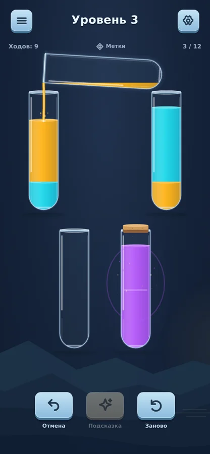
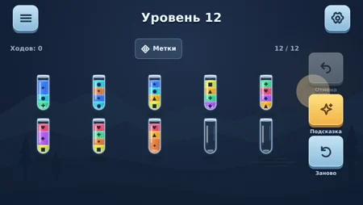

# Переливы 0.5 — жидкость и адаптивный интерфейс

24 октября 2026. Реализация плана после повторного пересмотра 0.4. Ночное оформление сохранено. Порядок: контакт жидкости со струёй → реальные колбы и раскладка → области нажатия → контекстные сообщения → визуальная проверка и APK.

## Изменения

1. **Контакт со струёй.** Угол определяется оставшимся объёмом: вместимость ниже нижнего края горлышка при наклоне должна совпадать с фактическим объёмом. Используется один округлый силуэт для расчёта и рендера. Во время перелива угол меняется непрерывно, при возврате убывает. Выбор стороны учитывает весь диапазон наклонов. Положение всей колбы остаётся внутри поля; при ограниченном месте струя может идти по диагонали к получателю. Это визуальная модель, не полноценная гидродинамика.
2. **Реальные места.** Число ячеек равно текущей сохранённой доске. Фиктивной недоступной колбы больше нет. Уже полученная дополнительная колба из старого сохранения остаётся видимой и рабочей.
3. **Маленький экран.** Допустимы пять колонок при достаточной ширине 48px целей. Уменьшены отступы в коротком поле. Стандартный плотный уровень на 320×480: два ряда вместо трёх, колба 27.22×95.5 CSS px вместо примерно 18×50.75. Размер цели 48×105.5. Это метрика стандартной доски из 10 реальных колб; она не обещает такой размер для произвольной доски с дополнительной колбой.
4. **Управление.** Меню, настройки, метки, Undo, подсказка, повтор и крестик имеют области минимум 48×48 на проверенных размерах. У верхних кнопок и крестика видимая форма отделена от области нажатия; оформление не требует увеличения пиктограмм. У настроек кликабельна вся строка переключателя.
5. **Сообщения.** На обычном поле после первых двух уровней нет постоянной инструкции. Выбор источника, поиск/показ подсказки, ошибка, очередь и победа продолжают показывать контекст. Полоса сообщений сохраняет размеры, чтобы появление текста не вызывало resize и прерывание переливания.
6. Подсветка у опоры летящей колбы остаётся на исходном месте и затухает с подъёмом.

## Проверка

- 17 unit/integration tests. Сохраняются проверки правил, свидетелей, истории, сохранений и границ траектории.
- Новый тест: 4960 промежуточных состояний реальных ходов по всем 12 witness-последовательностям на четырёх размерах. Проверяются совпадение поверхности с выходом струи (допуск 0.02 CSS px) и границы всего силуэта. Максимальное рассчитанное расхождение <0.001 px. [Метрики](polish-05/geometry.json).
- 12 браузерных сценариев: прежние 9, реальные ячейки/тихое поле, области нажатия и использование сохранённой дополнительной колбы. Проверка отмены очереди переведена на управляемые часы браузера, чтобы ожидание тестового раннера не превращало её в проверку уже исполненного хода.
- 30 кадров девяти размеров и двух тем; необработанных JS-ошибок нет. [Матрица](polish-05/capture.json).
- `tools/capture-outlet.mjs` фиксирует настоящий рендер на 280ms анимации длительностью 560ms с управляемыми часами браузера. Это гарантирует кадр активной струи. Обычный screenshot после реального sleep этого не гарантирует. Проверены шаги 1, 7, 9 и 12 уровня 3, включая малый остаток. [Метод](polish-05/outlet-capture.json).
- `tools/capture-feel.mjs` отдельно записывает реальный ход времени, Undo, завершение и подсказку. Видео без звука. Пауза часов для этого видео не применяется.
- TypeScript/production build проходят. Android versionCode 5, versionName `0.5.0-flow`. Пакет `.preview3` и тестовая подпись от 0.3/0.4 сохраняются; совпадение сертификата проверяется по финальному APK.
- Физический Android, субъективное прослушивание и тактильность не проверялись.

## Кадры

