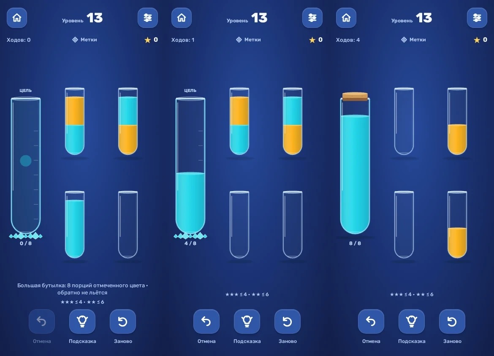

# 0.17 — большая бутылка и четыре учебных уровня

28 октября 2026. Следующий пакет после 0.16: настоящая механика большой цели, а не масштабированный обычный спрайт.

## Правила

На уровнях 13–16 есть одна неподвижная бутылка на **8 порций отмеченного цвета**. Она принимает только этот цвет, включая первое переливание в пустую цель. Обычным действием из неё не перелить; Undo возвращает последнюю порцию в исходную колбу без полёта большой бутылки. После заполнения большая бутылка остаётся большой. Кристаллическая подставка рассыпается, появляется пробка; если другие цвета ещё не собраны, уровень продолжается.

Это наши явно заданные правила. В записанном Magic Sort подтверждены высокая цветная цель и распад основания, но не точная вместимость и допустимость переливания обратно. Эти свойства не выдаются за установленную спецификацию конкурента.

Четыре порции целевого цвета в маленькой колбе ещё не означают собранный цвет: такую колбу нужно перелить в большую. Остальные цвета собираются обычным способом по четыре. Все слои открыты. Новой случайности, скрытой информации и изменения оценки старых задач нет.

## Уровни и звёзды

| Уровень | Цветов | Цвет большой цели | Идеал / две звезды |
|---|---:|---|---:|
| 13 | 2 | Бирюзовый | 4 / 6 |
| 14 | 3 | Фиолетовый | 13 / 16 |
| 15 | 4 | Жёлтый | 17 / 21 |
| 16 | 4 | Зелёный | 17 / 21 |

Это четыре вручную заданные раскладки, от короткого введения к смешанным задачам. На двухцветном вводном уровне рекламной колбы нет. С 14-го она доступна в отдельном зарезервированном слоте; добавление сохраняет цель и весь маршрут.

Пороги одинаковы с рекламной колбой и без. Для нынешних раскладок дополнительное место не уменьшает абсолютный математический минимум: оно даёт больше свободы искать маршрут. Точные A* решения и независимые bounded-search доказательства находятся в [optimal.json](audits/giant-17/optimal.json): все 16 уровней × два размера поля, 32 проверенных пути. Старые 12 раскладок, их идентификаторы, версии и пороги совпадают с 0.16. Общий возможный прогресс теперь 48 звёзд.

## Реализация

`Goal` — необязательное описание цели в метаданных уровня. Ёмкость, допустимые направления, проверка победы, сохранения/лучшие маршруты, Undo, Worker-подсказка и офлайн-решатель используют эту модель. Сохраняемый `Board` остаётся массивом слоёв; старые записи schema 1 принимаются без сброса. Правила цели не принимаются из пользовательского сохранения.

Канонизация решения переставляет только обычные колбы; фиксированную цель нельзя спутать с пустым обычным местом. Runtime поддерживает и другую позицию цели (отдельный тест); офлайн A*/проверяющий скрипт явно требуют слот 0, как во всех четырёх выпущенных задачах. Упаковка офлайн состояния расширена до 32 bit на колбу, чтобы хранить восемь слоёв. Обычный быстрый путь проверки победы и канонизации сохранён.

Новая раскладка оставляет цели отдельную колонку, а обычным колбам — непересекающиеся зоны нажатия от 48 px. На маленьком экране нормальные колбы укладываются в одну-две строки с промежутком 2 px между зонами. Высота и количество видимых мест не меняются от получения рекламной колбы. Жидкость рендерится относительно реальной вместимости; источник остаётся обычной колбой на четыре.

Пустая цель имеет цветной маркер, шкалу, подпись и счётчик `0 / 8`. При включённых метках она также показывает соответствующий символ. Завершённая цель сохраняет размер, счётчик `8 / 8` и пробку; подпись над горлом убирается, чтобы не пересекать посадку пробки. Reduced motion оставляет спокойное исчезновение основания. Все четыре оформления сохранены.

Выбор уже пройденного уровня теперь доступен даже при отсутствии отметки у предшественника; выбор по-прежнему начинает новую попытку с сохранённым рекордом. Это важно для корректных частичных/старых наборов отметок.

## Проверка

- TypeScript/Vite build, 35 core-тестов и 32 независимых проверки оптимумов.
- Локальный полный browser-прогон 104/104 перед заключительной полировкой; затем целевые giant/assistance и проверка символа. Полный CI выполняется для релизного commit.
- Проверяются неправильный цвет, запрет обычной отдачи, порции 4/6/8, очередь двух доставок без преждевременной награды, заполненная цель до общей победы, Undo/reload/повтор, неизменный размер, Worker-подсказка, rewarded-слот и рекорды.
- Поле и результат проверены на 320×480, 568×320 и 390×844; отдельные core-проверки — на непересечение 48 px целей.
- `tools/capture-giant-17.mjs` воспроизводит production-кадры валидными replay-сохранениями и реальным вводом, без CSS-подмен. `animations:'disabled'` лишь завершает конечный CSS fade оболочки при снятии PNG и не изменяет canvas-переливание.

Native SDK рекламы и установка/ощущения на реальном телефоне не проверялись. Debug использует прежний demo-блок Яндекса и прежний публичный preview-сертификат. Новые механики не используют материалы Magic Sort.

## Production-кадры

[Метаданные кадров](audits/giant-17/capture.json) фиксируют игровой commit, хеши production bundle и 18 изображений, четыре темы и размеры результата на трёх экранах. Кнопка продолжения имеет высоту 48 px и находится ниже поля. В последнем кадре превью цель уже собрана, но два жёлтых фрагмента ещё нужно объединить — это намеренный пример завершения цели до победы.

Тест постановки двух доставок в очередь останавливает browser clock только на вводе намерений, затем возобновляет обычное время и проверяет итог. Это не требует успеть считать промежуточную надпись на загруженном CI runner и не меняет время в продукте.
