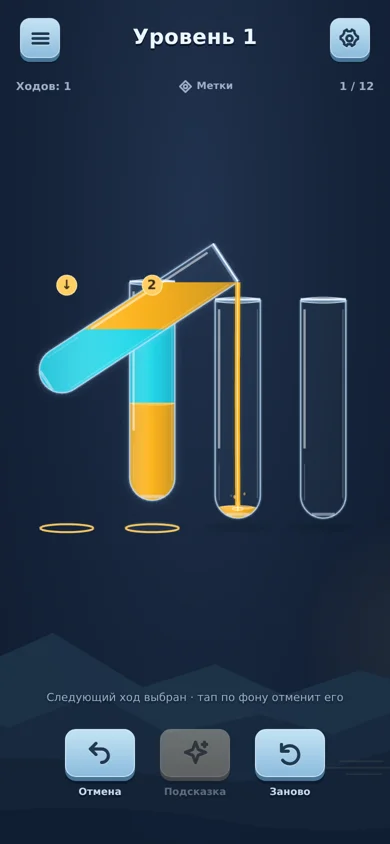
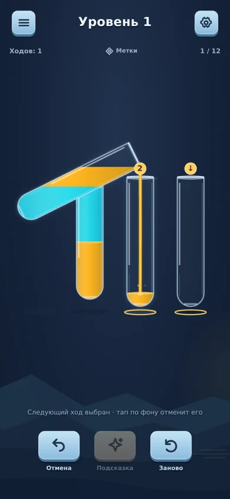
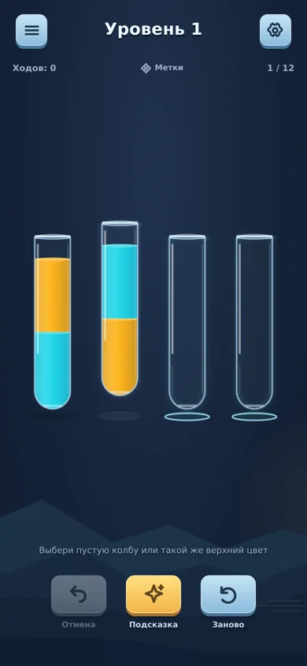

# Переливы 0.6 — предсказуемый ввод

25 октября 2026. Выполнен согласованный план после `UI_UX_FEEL_REVIEW_05.md`: одна очередь следующего хода, нейтральная смена источника, сообщение об отсутствии допустимых ходов, повтор без подтверждения до первого хода, проверка и APK.

## Поведение

- Во время переливания можно выбрать следующий ход по уже принятому состоянию доски. Это работает и для источника, и для получателя текущей анимации. В очереди только один ход. Он снова проверяется перед исполнением.
- Нажатие на другую колбу после готовой очереди начинает новый выбор, заменяя прежнее намерение. Тап по фону отменяет очередь/выбор. Undo, перезапуск, меню, поворот и прерывание приложения очищают намерение. После reload остаются только принятые ходы.
- Готовая очередь имеет золотой маркер «2» у источника и стрелку у цели. Это отдельное состояние от подсказки. Когда очередь готова, прочие возможные цели не конкурируют с её метками.
- Выбранная для следующего хода колба, в которую прямо сейчас льётся жидкость, остаётся неподвижной до окончания текущего перелива. Струя не теряет контакт с получателем.
- Другая непустая несовместимая колба становится новым источником без тряски, сигнала ошибки и противоречивой надписи. Тап по пустой колбе без источника даёт отдельное пояснение.
- Когда допустимых ходов нет, на поле появляется «Нет доступных ходов · можно отменить ход». Нет модального проигрыша или автоматического сброса. Проверяется только отсутствие легальных ходов; позиции с легальными, но бесперспективными продолжениями этим правилом не объявляются тупиком.
- До первого хода повтор выполняется сразу. При наличии истории сохраняется подтверждение и возможность продолжить прежнюю попытку.

## Валидация

- 17 unit/integration tests прежней логики/геометрии проходят.
- 12 прежних браузерных сценариев проходят. Добавлены 11: очередь через занятый источник в обычном/быстром режиме, использование занятого получателя как нового источника при замене, незавершённый выбор через конец анимации, Undo текущего/следующего хода, reload с очередью, единственная победа через очередь и рабочее продолжение, отсутствие двойного отклика смены источника, тупик/Undo, два режима повтора.
- Новые сценарии проверяют реальное продвижение приложения по наблюдаемым состояниям. Эксперимент с искусственными часами давал сброс `performance.now()` с 10000ms к сотням миллисекунд и ложное зависание текущей анимации. Эти проверки заменены реальным временем; повторные запуски не скрывают сбои игрового кода.
- `tools/capture-input-06.mjs` отдельно снимает статичные кадры очереди с остановленными часами и записывает видео с реальным ходом времени. В видео действительно приняты первая и победная очереди. Оно без звука. [Метод и результат](input-06/capture.json).
- Звук проверен на уровне вызываемых событий: смена источника запрашивает только выбор. Субъективное звучание и физическая вибрация на телефоне не проверялись. Темп и аудиобанк не менялись.
- Обычное/быстрое переливание остаются 560/320ms. Для одной и той же начальной задачи проверена работа очереди в обоих режимах; выбор предпочтительного темпа оставлен телефонной оценке.
- Android versionCode 6, versionName `0.6.0-input`; прежние package ID `.preview3` и подпись сохраняются. Совместимость сертификата дополнительно проверяется по финальному APK.

## Кадры

