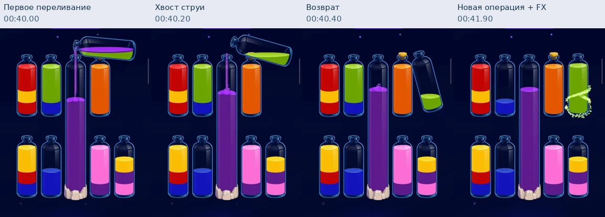
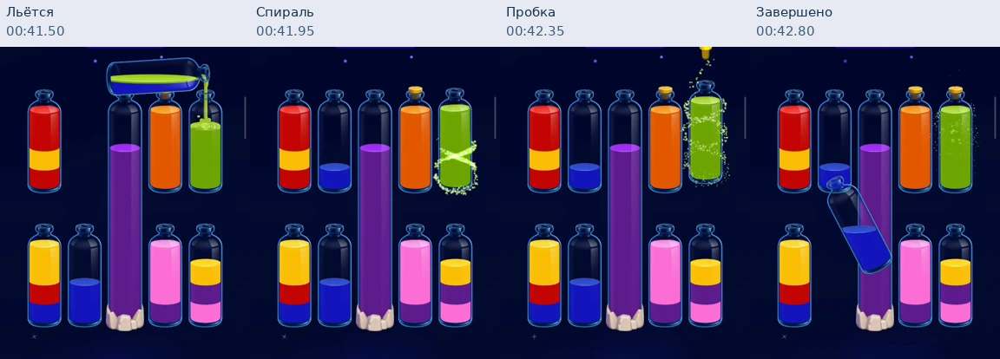
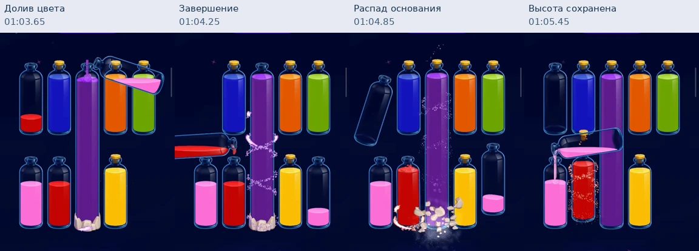
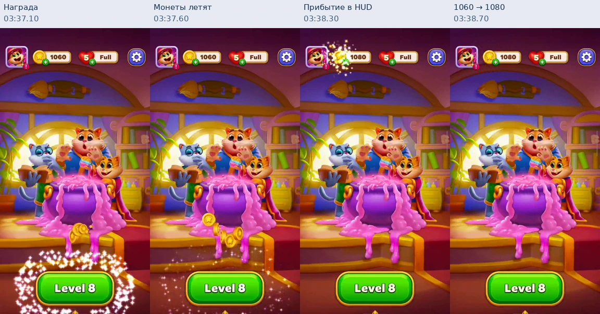
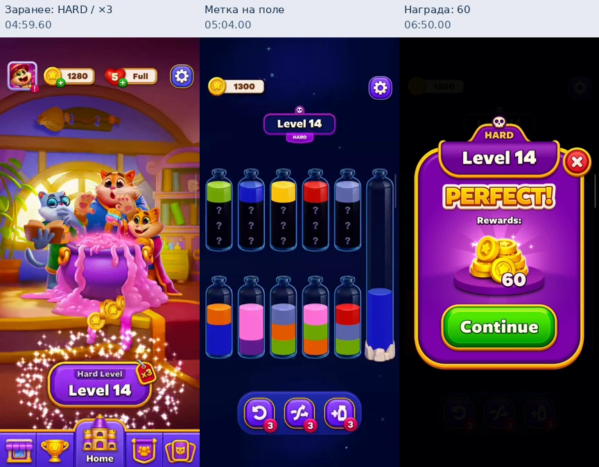

# Magic Sort: разбор двух записей и сравнение с «Переливами» 0.15

27 октября 2026. Это исследование, не релиз 0.16. Игровой код не менялся. Наша база: `f350d844c80857c9c768d06904c8835780f0edda` / APK 0.15.

## Главный вывод

У Magic Sort хорошо выстроена связь между действием и его последствиями: переливание наполняет предмет, завершение меняет его состояние, несколько завершений создают цепочку наград, победа превращается в осязаемые предметы, а предметы собираются в постоянный счётчик. Следующая цель появляется внутри этого же потока. Сильнее всего нам не хватает именно такой связности, выразительного завершения цвета и уровня, адресных микровибраций и видимого продвижения за пределы текущей задачи.

В записи хорошо видна непрерывность: хвост струи ещё долетает, источник уже уходит, завершённая бутылка празднует, а следующая операция начинается. Это не доказывает несколько независимых физических переливаний одновременно. У нас очередь тоже позволяет следующему переливанию сосуществовать с остаточными эффектами. Сравнивать нужно фазность и заметность, а не выдумывать отсутствующую функциональную разницу. Наш геймплей уже одобрен пользователем: менять всё сразу или заново переделывать утверждённое оформление A не требуется.

Высокая бутылка — отдельная крупная цель, заметно меняющая состав и геометрию поля. После завершения она остаётся высокой: разрушается основание и появляется пробка. Освобождение нового места запись НЕ показывает. Это принципиальное уточнение по полноразмерным кадрам.

## Материал и метод

- V1: `video_2026-10-27_17-20-07.mp4`, видео 497.187 с, контейнер 497.343 с, 576×1280, 12 061 кадр. Показаны уровни 10–15, большая бутылка, скрытые слои, hard 14, награды и Journey.
- V2: `video_2026-10-27_17-20-13.mp4`, видео 285.446 с, контейнер 285.513 с, 576×1280, 6 919 кадров. Показаны раннее обучение 1–4, уровни 5–9, настройки, магазин, Journey и Collection.
- Обзор всего хронометража: 195 кадров с интервалом 4 с. Ключевые события повторно исследованы на 5–10 кадрах/с и отдельных полноразмерных кадрах. Время в описаниях — относительно соответствующего файла, обычно с погрешностью около 0.1–0.2 с; обзорные листы грубее.
- Сопоставлены реальные текущие `WaterScene.ts`, `main.ts`, `sound.ts`, `rules.ts`, `solver.ts`, `session.ts` и Android `FeelHapticsPlugin.java`. Это анализ конкретной 0.15, а не предположение по старым скринам.
- Из аудио извлечены PCM-фрагменты, исследованы огибающая и спектр. Они позволяют обсуждать ритм и отдельные импульсы, но не удостоверяют приятность тембра на слух. Субъективное прослушивание на динамике/в наушниках здесь не подтверждено. Реальная вибрация не восстанавливается из MP4: «пык» каждой монеты — наблюдение пользователя с телефона.
- Игры конкурента не устанавливались. В записи нет точного времени каждого касания; задержку от тапа до реакции в миллисекундах по ней не измерить. Частота записи около 24 кадров/с не является доказательством FPS самого приложения.
- Технические подтверждения Android и дополнительные материалы о будущем просмотрены по официальным источникам [1–5]. Изображение магазина не доказывает правила нарисованного препятствия. Вторичные SEO-гайды не использовались как спецификация игры.

Хеши файлов и времена выбранных кадров: [sources.json](audits/magic-sort-16/sources.json). Контактные полосы воспроизводятся `tools/extract-magic-review-16.py FIRST.mp4 SECOND.mp4`. Полные пользовательские записи в git не копируются.

## Карта записей

| Файл / время | Событие | Что подтверждает |
|---|---|---|
| V2 00:00–00:32 | Компактный учебный прогон с надписью Levels 1–4: рука, короткие указания, постепенное увеличение поля | Обучение встроено в действие; четыре этапа не разрываются четырьмя полноценными победными окнами |
| V2 00:33–00:43 | Общая победа обучения, PERFECT, 20 монет, следующий уровень | Ранний цикл сначала быстро объясняет управление, затем выдаёт награду |
| V2 00:44–02:04 | Уровень 5; несколько последовательностей и длинная остановка на почти неизменном поле | Не вся длительность уровня — анимационная задержка; нельзя усреднять её как скорость механики |
| V2 02:05–02:36 | Уровень 6 и победа | Поле усложняется без постоянных объясняющих панелей |
| V2 02:37–03:35 | Уровень 7 с вопросительными знаками под верхними цветами | Скрытая информация уже участвует в реальной игре, это не только промо |
| V2 03:35–03:39 | Возврат домой, кнопка меняет 7→8, монеты летят к HUD, счётчик 1060→1080 | Заработанное физически связывается с постоянным балансом и следующей целью |
| V2 03:40–04:03 | Settings, Shop, Journey, Collection | Раздельные Sound/Haptic/Music; покупки; награды по пути; коллекция закрыта до 95 |
| V2 04:04–04:40 | Уровень 8 и завершение | Скрытые цвета повторяются после первого знакомства |
| V2 04:41–конец | Вход в уровень 9 | Запись не показывает всё дальнейшее развитие |
| V1 00:00–01:07 | Уровень 10, одна высокая бутылка | Её реальное поведение видно на заполнении и разрушении основания |
| V1 00:39–00:44 | Переливание, остаточная струя и завершение зелёного | Перекрытие движения, следов и награды; число одновременно исполняемых ходов не установлено |
| V1 01:03–01:05.5 | Завершение высокой фиолетовой и распад основания | Сильная награда за особую цель; нового свободного слота нет |
| V1 01:07–01:13 | Логотип/салют/победное окно/переход | Победа имеет несколько крупных визуальных фаз |
| V1 01:13–02:17 | Уровень 11 с двумя высокими бутылками | Один тип механики развивается в комбинацию, не требуется новый тип на каждом уровне |
| V1 02:26–03:26 | Уровень 12 со скрытыми слоями | Чередование типов поля |
| V1 03:33–04:56 | Уровень 13: скрытые слои + высокие бутылки | Знакомые механики объединяются |
| V1 04:59–05:04 | Домашняя кнопка Hard Level 14, значок ×3; затем HARD на поле | Вызов объявляется до начала и сохраняется в самой задаче |
| V1 05:04–06:46 | Прохождение hard 14 | Пик сложности использует уже показанные элементы |
| V1 06:49–06:57 | Победа с HARD/60, затем Journey и бесконечные жизни | Усиленная награда связывается с большой прогрессией |
| V1 07:01–08:17 | Уровень 15, финал, возврат домой | Последний цикл обрывается до полного завершения всех наградных анимаций; его баланс не экстраполируется |

## 1. Что происходит при обычном переливании

Бутылка поднимается над своим местом, перемещается к получателю, наклоняется, отдаёт цвет и возвращается. Струя заметна как отдельная связь двух объектов. У принимающей бутылки есть локальный контакт воды. Точки назначения остаются устойчивыми; пользователь не должен заново искать поле после каждого движения. Простое тёмное окружение и насыщенная непрозрачная жидкость помогают видеть изменение верхнего слоя.

Самые ценные свойства здесь — непрерывность и возможность заранее действовать. На V1 около 00:40.2 источник с оставшимся зелёным уже уходит от высокой бутылки, а фиолетовый хвост ещё долетает. Это не два доказанно независимых потока: часть воды уже оторвалась от горлышка. В других местах завершение цвета продолжается во время следующей операции.

В нашей 0.15 уже есть подъём с пружиной, струя, физическая геометрия жидкости, волна, посадка и одна очередь. Нельзя описывать её как игру «без анимаций». `WaterScene.flight` действительно один, а `drainQueue()` исполняется по окончании целого переливания. Но частицы и награда цвета живут дальше, поэтому их перекрытие со следующим ходом у нас тоже уже возможно.

Что перенести: сделать фазы хорошо читаемыми, сохранять след струи при уходе источника, запускать локальную награду в момент наполнения получателя. Новое действие не должно ждать конца частиц. Проверить уже имеющуюся очередь одинаковым ритмом нажатий на телефоне. Несколько активных переливаний можно отдельно прототипировать как наше улучшение, но запись не даёт оснований считать их обязательной недостающей функцией. Не установлены также глубина очереди конкурента и правила перенаправления занятой бутылки.

Точная геометрическая реалистичность не главный аргумент Magic Sort. По записи нельзя заключить, что их модель объёма физически точнее нашей. Нам полезнее сохранить уже работающую геометрию и улучшить ритм.

## 2. Завершение цвета — полноценное событие

Зелёная бутылка на V1 около 00:41.6 наполняется. Примерно в следующую секунду последовательно видны локальное свечение/частицы у основания, белая спираль вокруг тела, пробка над горлышком, её посадка и затухающий след. При этом рядом продолжается следующая операция. Итоговое состояние закрепляется пробкой: бутылка выглядит законченной даже после исчезновения эффекта.

Важно не количество частиц, а несколько различимых последствий одного успеха: жидкость дошла → предмет получил акцент → пробка закрыла его → законченное состояние осталось. Одновременно можно видеть награду старого действия и начало нового.

У нас `celebrate()` создаёт sweep, небольшие звёзды/частицы и пробку; `Sound.finish()` сочетает cork с complete/victory. Эффект существует, но масштаб и последовательность скромнее. Кроме того, `scene.onComplete` срабатывает после возвращения источника, и в этот же момент запускаются звук, вибрация и награда. Смысловой контакт «получатель только что наполнился» отделён от подтверждения.

Нужен один читаемый собственный пакет: короткая упругая реакция принимающей колбы, локальный цветной/белый след, выразительная посадка пробки, короткий материальный звук и отдельный тактильный акцент. Запуск — по факту визуального наполнения; добивание эффекта не блокирует поле. Не обязательно буквально копировать спираль или форму бутылки конкурента.

Запрет переливать из закрытой бутылки запись не проверяет. У нас собранная колба остаётся легальным источником; менять правило ради пробки не предлагается.

## 3. Большая бутылка: наблюдённое правило и зачем оно нужно

На уровне 10 высокая фиолетовая занимает по высоте место двух обычных бутылок и стоит на кристаллическом основании. В наблюдённых ходах в неё доливают фиолетовый. На уровне 11 таких предметов два — для оранжевого и жёлтого. Это визуально крупные одноцветные цели: их легко выделить в общий план решения.

На V1 около 01:03.6–01:05.3 происходит последовательность:

1. Последний фиолетовый доливается в высокую бутылку.
2. Вдоль её тела проходит белая спираль, идёт плотная россыпь, появляется пробка.
3. Основание распадается на заметные кусочки/частицы, падающие вниз за границы поля.
4. Бутылка сохраняет высоту и полный фиолетовый цвет. Новая пустая бутылка под ней не появляется.
5. Соседняя обычная бутылка празднует завершение красного, а игрок продолжает работу с розовым. Эти события сосуществуют с остатками большого эффекта.

На уменьшенном обзорном кадре легко спутать прозрачные соседние предметы и насыщенную вертикаль с двумя отдельными слотами. Полноразмерный кадр 01:05.45 показывает непрерывную высокую фиолетовую бутылку от верхнего ряда до нижнего. Интерпретация «схлопывается и открывает место» отвергнута. Нельзя строить на ней наше ТЗ.

Ценность наблюдённого приёма: у уровня появляется особая большая цель и более значительное событие её завершения. Знакомое действие — долив цвета — получает иной масштаб и композицию. Один такой предмет затем развивается в два; позже высокие цели совмещаются со скрытыми слоями. Это даёт разнообразие без введения новой кнопки управления.

Что не установлено: точная ёмкость в дискретных единицах; запрет выбирать её источником; допустимость другого цвета; возможность двигать её после распада основания. Не следует называть её доказанно «на 8 слоёв» или утверждать, что она принимает любой цвет. Наблюдённый факт — высокая одноцветная цель, постепенное заполнение, пробка и разрушение основания.

Для нас это интересная первая новая механика с полной информацией. Но сначала нужно явно выбрать собственные правила: ёмкость, состав цветов, можно ли выливать из неё и что означает завершение. Сейчас вместимость 4 зашита в правила, reverse, completeTube, validBoard, solver, геометрию/порции, генерацию и расчёт оптимумов. Проверка количества каждого цвета тоже требует ровно 4. Простое растягивание спрайта не создаст настоящую большую ёмкость.

Нужен проверенный банк с переменными ёмкостями/количествами цветов и отдельное визуальное завершение. Канонизация поиска по перестановке всех бутылок уже не подходит без учёта типа/ёмкости: особая высокая цель не эквивалентна обычной пустой бутылке. Пороги звёзд и польза рекламной колбы должны считаться заново для нового банка. Базовые выпущенные уровни и их сохранения сохраняются отдельной версией. Если мы захотим освобождение места как свою дополнительную награду, это отдельное решение, отсутствующее в доказательствах о конкуренте.

## 4. Победа: несколько масштабов награды

Один показательный цикл V1:

- Около 01:06 — завершение последней обычной бутылки.
- 01:07.3–01:07.8 — поле затемняется, в центре возникает крупный вращающийся/собирающийся знак Magic Sort.
- Далее идут золотистые частицы и разлетающиеся салюты на фоне. Поле остаётся узнаваемым, но перестаёт спорить за внимание.
- Примерно 01:11 — появляется большое победное окно с Level 10, PERFECT, предметной кучкой монет/20 и Continue. Заголовок собирается/подпрыгивает, монеты подсвечены.
- После Continue виден домашний экран; кнопка следующего уровня меняется и акцентируется, монеты летят к балансу.

У нас финал — локальные эффекты на бутылках, inline «Готово!», статичные звёзды и «Дальше». Положительная сторона — следующая задача доступна быстро. Слабая — победа слишком близка по масштабу к обычному служебному сообщению. Одна и та же текстовая строка не создаёт завершённого наградного эпизода.

Перенести стоит смену масштаба, последовательность и предметность. Ранее предложенные пользователем вылетающие пробки и цветные фонтаны хорошо подходят нашим колбам и могут стать своей отличимой наградой. После них — поочерёдные звёзды/рекорд, короткие подтверждения и доступный «Дальше».

Длинную принудительную паузу копировать не нужно. В показанном цикле от завершения до стабильной Continue проходит несколько секунд. Это заметная часть короткого уровня. Наша стартовая цель: основное шоу около 0.8–1.2 с, управление продолжением доступно без ожидания окончания хвостов. Числа — предлагаемый прототип, не измеренные оптимальные тайминги. Нажатие «Дальше» завершает косметику и немедленно переносит на новый уровень.

## 5. Монеты и микровибрации

На V2 около 03:37.1 появляется россыпь у кнопки следующего уровня; монеты движутся по сходящимся траекториям к левому верхнему балансу. В районе 03:38 монеты достигают HUD, там возникает локальная вспышка, счётчик переходит с 1060 к 1080. Пользователь отдельно подтвердил маленький тактильный «пык» каждой собираемой монеты.

Почему это сильнее простого +20:

- У награды есть место появления, тело и цель движения.
- У каждой части есть момент прибытия — повод для маленького звука, импульса и реакции счётчика.
- Пачка коротких подтверждений продлевает удовольствие от одного успешного уровня.
- Постоянный счётчик связывает успех сейчас с возможностями позже.
- В это же время меняется кнопка следующего уровня: прошлый успех буквально приводит к следующему действию.

В извлечённом аудио для V2 03:33–03:42 видно несколько коротких высокочастотных импульсов около 03:38.30, .37, .49, .56, .64. Это подтверждает наличие пачки событий в окне прибытия награды, а не один неизменный звук на весь экран. Из смешанной моно-дорожки нельзя достоверно отделить все источники или доказать точное соответствие каждого импульса каждой нарисованной монете. Силу вибрации этот анализ не измеряет.

У нас монетной экономики нет. Добавлять валюту без понятного расходования сейчас не требуется. Тот же принцип можно реализовать на уже имеющихся звёздах: появление по одной, материальный контакт/сбор, мягкий импульс на каждое прибытие, итоговый прогресс. Для нового рекорда показывать реальное приращение общего числа лучших звёзд. Повторное прохождение на те же 3 звезды не должно бесконечно увеличивать баланс.

Если позже появятся монеты, сначала решить, на что они тратятся и за что выдаются. Все четыре выпущенные темы остаются бесплатными. Новые наградные оформления могут появиться отдельно; отбирать уже доступные темы ради экономики нельзя.

### Тактильная система нашей игры

Сейчас нативный плагин принимает только strong: обычный CLOCK_TICK и, на подходящих Android, CONFIRM. В JS есть импульсы выбора, принятия/очереди хода и завершения цвета/уровня. У большинства UI-кнопок, Undo, прилёта предметов и посадки пробки отдельных тактильных событий нет. На старом Android сильный вариант может совпасть с обычным.

Нужны именованные события, согласованные с визуалом и звуком:

| Событие | Характер | Момент |
|---|---|---|
| Выбор колбы | Очень короткий лёгкий tick | Реальный выбор, без повторов от перерисовки |
| Принятое переливание / очередь | Лёгкое подтверждение | Один раз на принятый ввод; повтор при исполнении очереди не нужен |
| Обычная кнопка / тема | Маленький click/tick | Принятое действие, одинаково у похожих кнопок |
| Отказ хода | Отличимый мягкий отказ | Только осмысленная ошибка, не каждый тап по фону |
| Завершение цвета | Более выразительное подтверждение | Наполнение + начало локальной награды |
| Звезда/монета достигла цели | Самый мягкий короткий импульс | На прибытие каждого видимого объекта |
| Финал уровня | Отдельный короткий акцент | Общий кульминационный момент |

Android рекомендует согласовывать важность, частоту и силу событий, синхронизировать их с графикой/звуком и предпочитать чёткие короткие ощущения длительному дребезгу [3–5]. На новых API есть специальные очень мягкие частые tick; на старых устройствах нужна подходящая проверенная замена, а иногда отсутствие эффекта лучше грубой вибрации. Точная амплитуда не универсальна для телефонов. Не задавать всё одной длинной `vibrate(N)` и не обходить системное отключение.

Серия из нескольких событий должна отменяться при уходе в фон, смене уровня, открытии полноэкранной рекламы и выключении вибрации. Пропущенные импульсы не доигрываются после возврата. Для массового одновременного прибытия предметов ограничить плотность: не превращать отдельные «пыки» в непрерывное жужжание. Проверка на телефоне обязательна для выбора профиля; наличие вызова API не доказывает приятность.

## 6. Звуковая часть: что меняем у нас

Записи не дают оснований заявлять наш звук качественно прослушанным или измерять «приятность» конкурента. Однако причинную структуру награды можно установить по видеоряду и транзиентам: отдельные контакты и пакет прибытия требуют отдельных коротких событий, а не одного длинного победного файла.

Наши complete/victory сделаны из Kenney pluck; это документировано в AUDIO_CREDITS и воспроизводимом build-audio.py. Пользователь воспринимает именно характер завершения как 8/16-bit. Формат файлов Vorbis и sampled-реализация не исправляют эту эстетическую проблему. Нужно заменить источник характера, а не просто приглушить или повысить частоту текущего акцента.

Подходящая направленность: вода, стеклянный контакт, пробка; для сбора награды — мягкий предметный tick/звяканье. Незначительная вариативность нужна против механического повторения; нарастание награды лучше делать слоями и ритмом, без обязательной синтезаторной гаммы.

При добавлении параллельных переливаний нынешние четыре общих голоса требуют внимания: два потока и несколько завершений уже способны вытеснять друг друга. Нужны приоритеты/ограничения на группы эффектов и понятное затухание, а не бесконтрольное увеличение общей полифонии. Приятность нового банка нужно отдельно проверить в наушниках и на динамике телефона.

## 7. «Сложный уровень» — цепочка ожидания и выплаты

Уровень 14 выделен заранее: домашняя кнопка меняется с зелёной на специальную фиолетовую, появляется Hard Level и значок ×3. На поле остаётся более заметная рамка/HARD. После победы статус HARD присутствует и на наградном окне; сумма 60 против видимых обычных наград 20. Баланс после завершения 13 был 1300, после награды hard 14 — 1360.

Работает не одна надпись, а договор: впереди вызов → игрок узнаёт его в поле → успех особо отмечен → выплата оправдывает ожидание. Это делает порядок уровней менее ровным. Следующий обычный уровень может восприниматься как выдох.

У нас нет difficulty в метаданных и отдельного оформления таких этапов. Добавить видимый лейбл недорого, но сначала надо выбрать действительно более трудные задачи. Количество цветов и длина оптимального пути сами по себе не достаточны: важны свобода буферов, количество неудобных решений/возвратов и реальные затруднения людей. Число узлов алгоритма тоже зависит от эвристики и не равно сложности для человека.

Предложение: одинаковая метка «Сложный уровень» перед стартом, на поле и после успеха; короткий входной акцент, более выразительная победа. По-прежнему без таймера и обязательной покупки. Пока нет монет, не показывать выдуманное ×3 и не менять смысл трёх звёзд за идеальное прохождение. Дополнительная постоянная награда возможна после появления соответствующей метасистемы.

## 8. Будущие механики: подтверждённое, показанное в меню и предположительное

| Элемент | Доказательство | Что известно | Наш приоритет |
|---|---|---|---|
| Обычная сортировка | Обе записи | Базовое правило и перенос верхнего цвета | Уже есть; сохранить |
| Скрытые слои `?` | Реальный геймплей V2 с 7 и V1 12–15 | Ниже верхнего слоя цвет закрыт; открывается по мере снятия верхнего | Позже, после отдельного решения о справедливости звёзд |
| Высокая одноцветная цель | Реальный геймплей V1 10–14 | Финал добавляет пробку и разрушает основание; высота сохраняется | Первая кандидатура на новую механику |
| Сочетание высокой цели и скрытых слоёв | V1 13/14 | Комбинируются уже известные элементы | После хороших отдельных обучающих задач |
| Hard / усиленная награда | V1 14 | 60 вместо 20, явное предварительное объявление | Дёшево по UI, требует проверки банка |
| Undo / Shuffle / +1 | Кнопки с запасом 3 в записях, названия в описании разработчика | Наличие инструментов; алгоритм Shuffle не продемонстрирован | Наши Undo/подсказка/rewarded уже решают помощь; лимиты не копировать |
| Journey | V1 06:54, V2 03:58 | Путь с наградами; на 15 — бесконечные жизни, видны 25 Undo ×1, 30 бесконечные жизни 1h, 35 Shuffle ×1 | Сокращённый путь с наградными темами возможен позже |
| Broom Flight 20–39, Purr-tal Jump 40–59 | Закрытые карточки Journey | Обещаны следующие главы/сцены | Это не доказательство новых правил мини-игры; не планировать их по названию |
| Collection | V2 04:02 | Прямо написано Unlock Collection at Level 95 | Дорогая мета; не нужна раннему прототипу |
| Жизни / временный безлимит | Домашний HUD, Journey, Shop | 5/Full, таймер/∞ после награды | Отдельная экономика; сейчас не добавлять |
| Магазин пакетов | V2 03:50 | Монеты, инструменты, временные бонусы и покупки | Не переносить вместе с feel автоматически |
| Лёд, занавесы, цветные замки/ключи, покрытые бутылки, числовые подставки | Официальное промо-изображение [1] | Такие предметы нарисованы | Точные правила/порядок открытия не проверены; нужны записи настоящих уровней |

У разработчика в просмотренных официальных материалах не обнаружена полная спецификация препятствий. Нельзя честно утверждать «мы уже знаем все будущие механики Magic Sort». Нужны целевые записи новых элементов: появление и инструкция → попытка допустимого/недопустимого взаимодействия → условие снятия ограничения → влияние Undo/повтора. До этого промо — список вопросов для проверки, не готовое ТЗ.

### Почему скрытые цвета не стоит копировать первыми

В текущем нашем дизайне три звезды требуют оптимального маршрута, а дополнительные колбы должны давать свободу искать его. Если ключевой цвет скрыт, первое прохождение может требовать удачного угадывания даже при аккуратной игре. Сравнивать человека с оптимумом решателя, который знает всю скрытую раскладку, нечестно.

Возможные будущие решения: отдельный режим без требования абсолютного оптимума; оценка после изучения/повторного прохождения; другая метрика качества. Выбор нужно сделать до появления тумана, а не подкручивать пороги постфактум. Runtime-подсказка также не должна выдавать сведения о невидимых цветах без явно объявленного правила.

В отзывах на официальной странице [2] действительно есть жалобы на роль угадывания, скрытой информации и платного продолжения. Это отдельные самоотобранные отзывы, не измеренная доля аудитории и не доказательство мошенничества. Они показывают конкретный риск для нашей системы справедливых звёзд.

## 9. Мета: зачем игроку следующий уровень

Домашний экран конкурента даёт узнаваемую сцену, постоянный баланс, жизни, большую кнопку текущего уровня и несколько будущих направлений. Journey показывает ближайшую выплату и закрытую следующую главу. Collection оставляет дальнюю цель. Награда поддерживает ожидание того, что будет после ещё нескольких уровней.

У нас 12 задач, выбор уровней, рекорды и четыре свободные темы. Есть локальная цель «собрать на 3 звезды», но нет следующего видимого открытия за этими звёздами. Это важнее необходимости срочно заводить много валют.

Подходящий маленький вариант: общий прогресс лучших звёзд, одна видимая следующая косметическая награда и её предварительный просмотр. Новые темы/варианты материала — умеренная стоимость производства. Не нужен котёл, персонажи, ремонт комнат, коллекция из десятков карточек и пять вкладок. При этом уже выпущенные четыре темы остаются доступными.

### Дополнительные UI/UX-наблюдения

- На игровом экране постоянный HUD скромный: баланс, настройки, номер уровня и три инструмента. Домашний экран существенно богаче. Нам не нужно переносить всю мету на поле; наши ходы/цели звёзд имеют смысл из-за иной системы оценки.
- У инструментов один предметный материал, общий контейнер и отдельные красные счётчики запаса. Бейдж означает количество доступных применений, а не декоративную точку. У нас бесплатные действия не следует снабжать вымышленными счётчиками ради похожей картинки.
- Повторяемое PERFECT в показанных победных окнах не доказывает оптимальность маршрутов. У конкурента в кадре нет нашей шкалы 1–3 звезды по ходам. Надпись «Идеально» у нас должна соответствовать реальному условию, а не любой победе.
- На домашнем экране двигаются персонажи/содержимое котла, кнопка следующего уровня делает заметный акцент, выбранная вкладка выделена формой. Эти микросостояния делают меню живым. Наш короткий нажим уже есть; крупная иллюстрация пока статична. Один мягкий редкий акцент основной кнопки или короткое оживление колб после возврата дешевле постоянной анимированной сцены. Бесконечное подпрыгивание всех кнопок не нужно.
- Учебная рука указывает конкретный предмет. У нас обучение текстовое. В качестве небольшой доработки можно показывать жест после паузы на первом запуске и сразу убирать после правильного действия; не превращать все уровни в обучающий оверлей.
- В Settings отдельно доступны Sound, Haptic и Music. Это свидетельствует о разделении пользовательских предпочтений, но не об обязательности добавлять музыку нам. В нашем ближайшем пакете важнее качество игровых звуков и микровибраций.
- В Settings видна награда за Facebook sign-in — бесконечные жизни на 1 час. Показаны также уведомления и поддержка. Поток входа не записан; собственная авторизация/облачные сохранения не должны автоматически попадать в scope ради такой карточки.
- Возврат через домашний экран после каждого уровня даёт возможность показать монеты и мету, но добавляет ещё одно действие до следующей задачи. Для нашей короткой игры полезнее сохранить прямой «Дальше», а награду собрать прямо на экране результата.

## 10. Сводка: что есть у нас и где разница

| Область | 0.15 | Разница по записи | Решение |
|---|---|---|---|
| Оболочка | Утверждённая система A, Rubik, четыре темы, нажатия/окна | У конкурента единый предметный мир, не только цвет | Не начинать новый редизайн; довести события и собственную награду |
| Переливание | Геометрия, струя, волна, посадка, очередь | Хвосты и локальные награды сосуществуют со следующими операциями; внутренний scheduler неизвестен | Сначала довести фазность и проверить нашу очередь; параллельность не объявлять обязательной |
| Цвет | Частицы, sweep, пробка, sampled акцент | Сильнее фазность и связь с моментом наполнения | Перенести событие награды ближе к контакту, сделать завершение предметным |
| Победа | Inline сообщение, звёзды, общая вспышка бутылок | Несколько крупных фаз и предметная выплата | Пробки/цветные фонтаны + живые звёзды, доступное продолжение |
| Haptics | Два варианта strong, несколько игровых вызовов | Подтверждения мелких событий, по словам пользователя | Словарь событий и адресная синхронизация |
| Звук | Water/glass samples + pluck finish | Нужна связь по событиям; приятность не установлена измерениями | Заменить отклонённые pluck, свести с новой тактильной/визуальной цепочкой |
| Трудность | Оптимумы/звёзды, без difficulty-метки | Вызов заранее объявлен и особо оплачен | Отметить проверенные пики, без выдуманного множителя |
| Разнообразие | Все ёмкости 4, полная информация | Высокая цель меняет состав/силуэт поля; есть туман | Сначала высокая цель, туман позже |
| Мета | Лучшие результаты и выбор темы | Есть видимый следующий milestone | Небольшой путь на базе звёзд после расширения банка |
| Монетизация | Добровольная rewarded-колба, бесплатные Undo/подсказки | Запасы инструментов, монеты, жизни, IAP | Не переносить ограничения помощи ради визуального сходства |

## 11. Порядок работ

Это рекомендация после анализа, а не уже выполненные изменения и не обязательство копировать все системы конкурента.

### Пакет A — закрыть feel на нынешних правилах

1. Заменить complete/victory pluck на материальный банк. Переслушать не отдельно, а в цепочке «выбор → струя → полный цвет → финал».
2. Сделать завершение цвета по моменту наполнения, с пробкой, различимыми фазами, звуком и импульсом. Движение остальных объектов продолжается.
3. Реализовать согласованную ранее победу с вылетом пробок/цветными фонтанами. Поочерёдно показать звёзды; коротко собирать реальное приращение общего прогресса. Микровибрация — на каждый видимый контакт/прибытие.
4. Событийные профили тактильного ответа для кнопок, выбора, подтверждения, цвета, финала и сбора награды. Системные настройки и тумблер соблюдаются.
5. Без задержки «Дальше», повторной награды после загрузки и повторного увеличения звёзд за тот же рекорд. Прерывание отменяет косметические хвосты.

Ориентир размера работ — средний. Это главный следующий пакет, а не новая экономика.

### Пакет B — проверка ритма и пики сложности

1. На одинаковой последовательности сравнить нашу очередь, первый контакт струи, момент наполнения, отлёт и возврат. Изменять конкретные задержки, если они ощущаются, а не ускорять всё по умолчанию.
2. Если остаётся реальная необходимость, отдельно прототипировать два независимых переливания как наше улучшение. Это гипотеза, не установленная функция конкурента. Занятые бутылки блокируются адресно, сохранение идёт в порядке принятых действий; проверить Undo/Hint/фон/победу и отменить прототип, если он ухудшает ясность.
3. Отметить реально трудные задачи; добавить согласованные метки перед/во время/после. Никакого ×3 без настоящей награды.

Лейбл дешёв по интерфейсу, проверка трудности требует работы с банком. Параллельность — средняя/высокая стоимость и риск регрессий; она не должна автоматически попасть в обязательный ближайший scope.

### Пакет C — первая новая механика

Высокая одноцветная цель → постепенное заполнение → особая пробка/распад основания. Сначала несколько проверяемых учебных задач, затем сочетания. Новая версия банка, обратная совместимость, новый расчёт оптимумов с рекламной колбой и без. Это высокая стоимость относительно косметики; не включать вместе с аудиополировкой.

### Пакет D — маленькая мета

Расширить банк за пределы 12 задач; показать путь к следующей косметической награде на основе лучших звёзд. После проверки ценности решить, нужны ли монеты. Скрытые слои, ключи/замки и прочие ограничения — отдельные будущие решения, а не обязательный список для немедленного копирования.

## Критерии приёмки ближайшего пакета

- По одному завершению цвета без чтения текста понятно, какая колба закончена и в какой момент.
- Каждому тактильному/звуковому акценту соответствует видимое событие; нет удвоения при исполнении очереди или повторной перерисовке.
- Победа ощутимо крупнее завершения одного цвета; хвосты не блокируют следующий уровень.
- Звёзды/рекорды сохраняются до косметики и не начисляются повторно из callback анимации.
- При смене экрана, фоне, рекламе, Undo и повторе нет «призрачных» звуков, вибраций и частиц.
- На 320×480 и landscape эффект не закрывает кнопку продолжения; reduced motion имеет спокойный вариант.
- Телефонное сравнение обычного и быстрого режимов: слышимость на динамике/в наушниках, короткость частых haptic, отсутствие дребезга и слуховой усталости. Автотесты это не заменяют.

## Источники и границы утверждений

Основные доказательства — две записи пользователя и текущий код 0.15. Видео-таймкоды относятся именно к этим файлам; глобальные версии Magic Sort, A/B-тесты и следующие уровни могут отличаться.

1. Официальная страница Magic Sort и промо с препятствиями: https://play.google.com/store/apps/details?id=com.grandgames.magicsort — просмотрены описание и отдельные изображения. Иллюстрация с занавесами/льдом/ключами показывает форму предметов, не все правила.
2. Официальная App Store страница, описание и отзывы: https://apps.apple.com/us/app/magic-sort/id6499209744 — отзывы иллюстрируют риски тумана/платного продолжения, не доказывают частоту проблемы.
3. Android Haptics design principles: https://developer.android.com/develop/ui/views/haptics/haptics-principles — согласованность, сила/частота, синхронизация и отказ от долгого дребезга.
4. Android haptics API reference: https://developer.android.com/develop/ui/views/haptics/haptics-apis — выбор API, требования поддержки и fallback.
5. HapticFeedbackConstants: https://developer.android.com/reference/android/view/HapticFeedbackConstants — CONFIRM, CLOCK_TICK, SEGMENT_FREQUENT_TICK и версии доступности. Частые tick API 34 описаны как очень мягкие и могут отсутствовать, если подходящий эффект недоступен.
