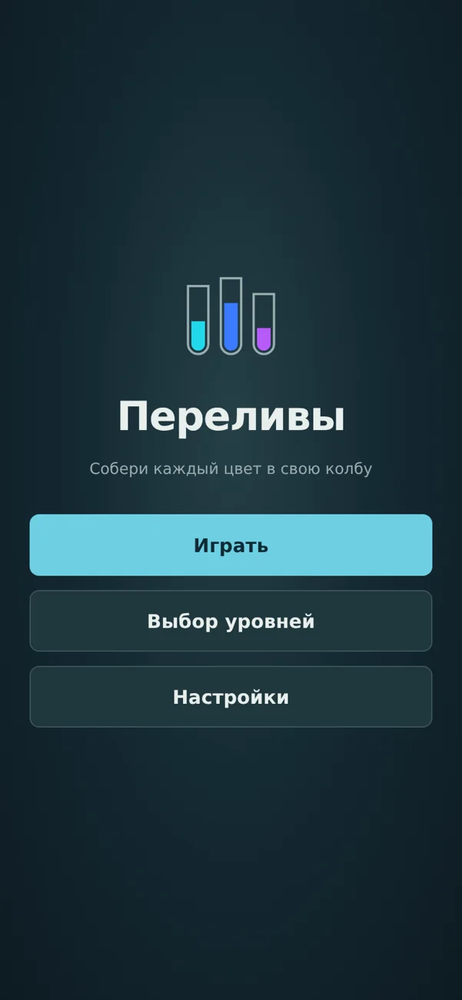
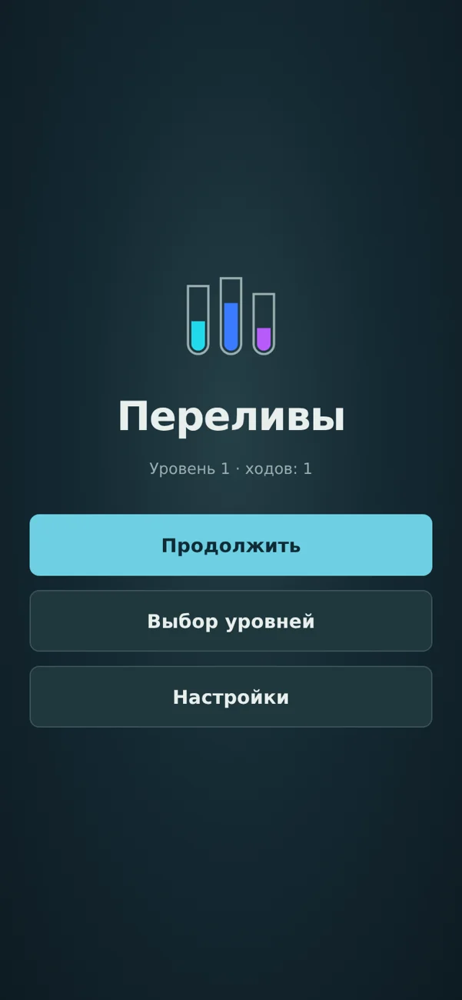
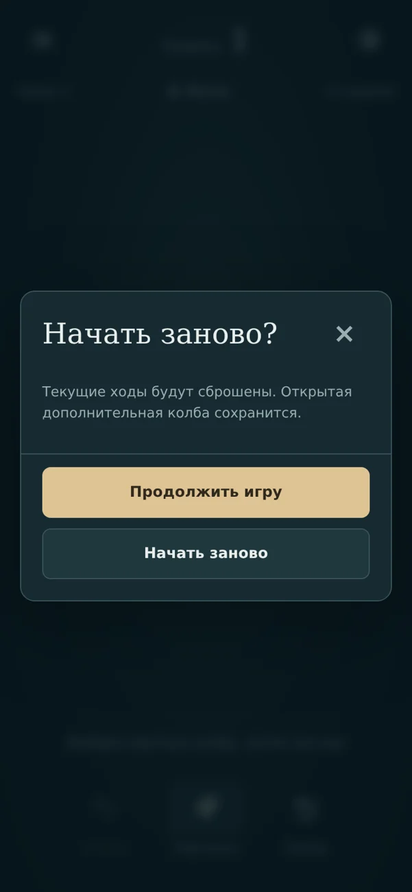

# Главное меню и переигрывание — 0.13

Первый пакет принятого [плана плейтеста](PLAYTEST_PLAN_13.md).

## Поведение

- При запуске показывается отдельный главный экран «Переливы»: Играть/Продолжить, Выбор уровней, Настройки. Первый запуск и настройка звука сами по себе не начинают попытку; первое Играть сохраняет её даже до первого хода.
- Продолжить возвращает точную текущую попытку. При выходе в главное меню во время переливания сохраняется уже принятый ход; ожидающее следующее намерение отменяется.
- Выбор любого доступного уровня, в том числе текущего и уже завершённого, начинает его с исходной раскладки. Сохраняются пройденные уровни и открытая дополнительная колба выбранного уровня. Попытки других уровней не сбрасываются.
- Заново всегда открывает подтверждение — в том числе на пустой истории. Основная кнопка подтверждения «Продолжить игру» безопасна; «Начать заново» сбрасывает только попытку. Открытая колба сохраняется.
- Если сброс не записался, прежняя попытка остаётся доступной. Ошибка показана в диалоге или на главном экране. Чтение повреждённых/недоступных сохранений сохраняет прежний защитный сценарий.
- Настройки доступны из игры и главного меню. Закрытие возвращает туда, откуда они открыты. Escape из игры открывает главное меню; из диалога закрывает диалог. Android Back использует ту же логику, а на главном экране вызывает выход из приложения.

## Проверка

59 прежних браузерных сценариев переведены на реальные переходы через главное меню и проходят. Добавлены 10 отдельных сценариев первого запуска, сохранения попытки, Escape/reload, переигрывания завершённого и незавершённого уровня, выбора другой попытки, отмены перезапуска, ошибки записи, отмены очереди и размеров 320×480/568×320. Новый код навигации не содержит специального тестового обхода меню.

Звёзды, рекорды и реклама будут следующим пакетом. Сейчас сохраняется существующий прогресс completed и extra; отсутствующие рекорды не выдаются за реализованную функцию. Оформление меню — функциональная оболочка до конкурентного разбора, без утверждения новой художественной концепции. Звук и эффекты переливания в этом пакете не менялись. Физический Android Back и жизненный цикл на телефоне ещё не проверены.

Локальная финальная проверка: 23 теста ядра, 69 браузерных, production build и cap sync прошли. Production-захват: 12 кадров, errors=[], продолжение после reload сохраняет историю из одного хода, выбор текущего уровня обнуляет историю. Проверка очереди вызывает настоящий обработчик кнопки меню при появлении ожидающего намерения, без подмены часов и без удлинения анимации.

Первый CI-запуск остановился на новой проверке очереди: геометрия и наблюдатель вычислялись уже во время движения, и медленный runner не успевал создать ожидающее намерение. Подготовка перенесена до начала первого хода, координаты измеряются один раз. Все проверки условий сохранены; игровой код и длительность движения не менялись. После исправления сценарий прошёл пять повторов подряд локально.

## Android-артефакт

CI run 40480123297 прошёл полностью: 23 теста ядра, 69 браузерных, build, cap sync, assembleDebug. Игровой код: e53dc6b228d9039dff97c3a2b0a4a567cdd98960; уточнение проверки очереди: c0a08f21e84b19df7ba785aa072e77e47969e5ec.

APK: 4625225 байт, SHA-256 `342e4523a8941c76853e691b4e202525ecce15c53c3d7c59047e613ffaa1d757`. Пакет preview3, versionCode 13 / 0.13.0-navigation. Сертификат совпадает с 0.12. Все dist-файлы побайтно совпадают с assets/public; ZIP цел, 11 OGG сохранены. Главный bundle: assets/public/assets/index-BHDrVgGO.js.
