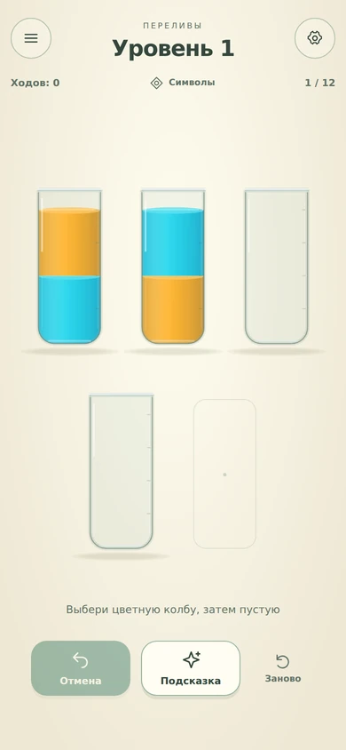
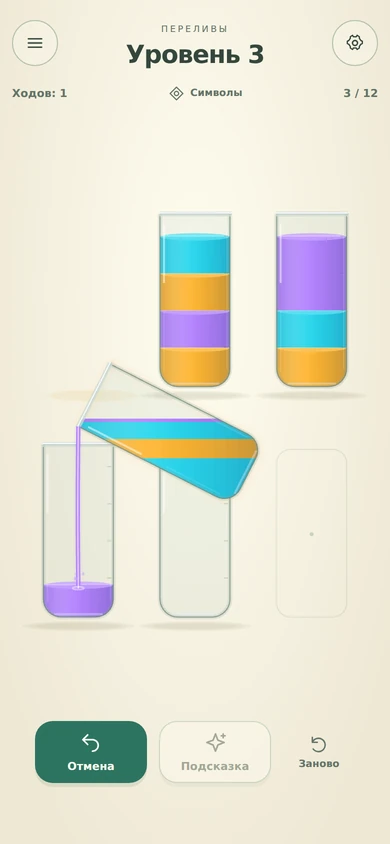
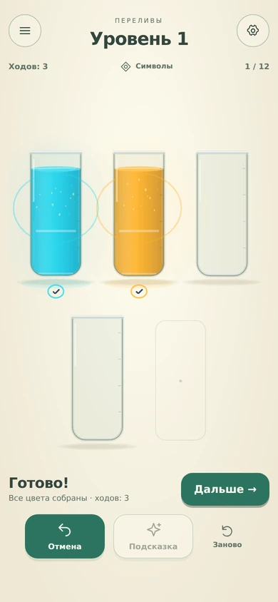
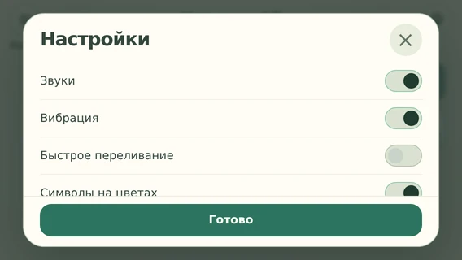
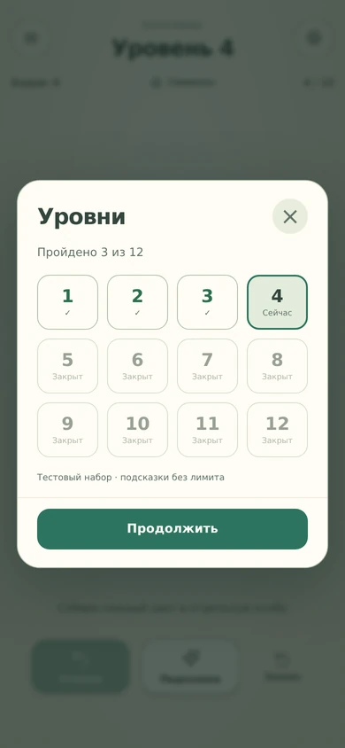
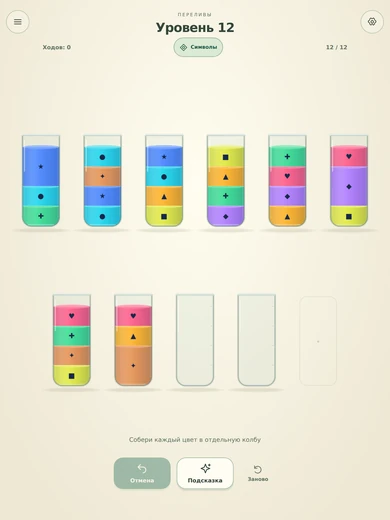

# Полировка 0.3 — 24.10.2026

Исполнение плана после UI/UX-аудита 0.2. Банк и монетизация остаются в объёме feel-прототипа. Проверка на физическом телефоне и субъективная приёмка звука/тактильности не подменяются браузером.

## Главное изменение поведения

Победа теперь является явным состоянием интерфейса: кнопка «Дальше» выводится из сохранённой позиции. Она остаётся доступной после перезагрузки, поворота и прерывания последнего хода. Завершённая раскладка видна целиком, модальное окно больше не перекрывает результат.

Подсказка действительно выбирает источник и указывает цель стрелкой. Другой ручной выбор отменяет подсветку/незаконченный поиск. Тап по фону отменяет отложенный ход. Undo очищает отменённые награды и проигрывает короткий обратный перенос без повторной выдачи победного эффекта.

## Рендер и геометрия

- Плотность canvas ограничена 2×. Размер сцены и hit testing остаются в CSS-координатах; символы получают соответствующее разрешение текстуры. На DPR 3 проверен canvas/CSS ratio ≈2 и реальное исполнение хода тапом.
- Раздельные интервалы X/Y и области нажатия. Эксклюзивные цели не меньше 48×48 на проверенной матрице, включая короткий альбом. Максимальный размер планшета и предпочтение меньшего количества рядов пересмотрены.
- Траектория выбирает сторону/наклон по доступному месту. На промежуточных кадрах учитывается весь силуэт, не только носик. Проверены 1680 траекторий (7 чисел мест × 4 размера × все пары) по 25 позициям — 42000 проверок границ.

## Оформление и feel

- Нейтральный тёплый светлый фон, спокойный тёмный зелёно-серый; более мягкие отражения стекла, меньше металлического блика жидкости. Новые установки начинают со светлой темы; сохранённый выбор темы не меняется.
- Частая отмена стала основным инструментом, подсказка — отдельной помощью, повтор — вторичным действием. Символы доступны прямо с поля компактным явным переключателем.
- Меню различает текущие/пройденные/закрытые уровни. Настройки используют единые переключатели; заголовок, крестик и подтверждение остаются видимыми при прокрутке на коротком экране.
- Тень остаётся у опоры, подъём затухает без бесконечного покачивания. Поверхность имеет короткую деформацию, струя и её отклик зависят от объёма. Добавлены тихие деления и адаптивные символы.
- Короткое появление нового поля, обратное движение Undo, локальные капли/блики вместо повторяющегося текста над каждой колбой.
- Звук имеет мягкое прерывание, отдельные тихие UI/Undo-акценты и небольшой рост тона завершённых цветов. Старые источники CC0 сохранены. Ошибка/опоздание загрузки не блокирует ход и не вызывает поздний чужой акцент.

## Связь с аудитом

| Пункты | Изменение | Проверка / остаток |
|---|---|---|
| F01 | Управляемые 2× и логические координаты | DPR 3 + реальный ввод проходят; FPS/память телефона ещё не измерены |
| F02 | Безопасный план/границы траектории | 42000 промежуточных проверок, повтор кадра проблемного перелива |
| F03 | Постоянное продолжение сохранённой победы | Последний ход → поворот → reload → следующий уровень проходит |
| F04 | Один выбранный источник, отдельная стрелка цели, отмена поиска ручным вводом | Исполнение подсказки, смена источника и опоздавший worker проверены |
| F05 | Очистка представления при Undo/прерывании | Просмотр кадра обратного хода, старой надписи/награды нет |
| F06 | Эксклюзивные цели X/Y | Проверена матрица размеров, всех чисел мест и соседних прямоугольников |
| F07–F09 | Опора тени, поверхность, объём струи | Реализовано; просмотр кадра перелива, телефонный feel требует оценки |
| F10–F12 | Контраст/иерархия, переключатели и каталог | Кадры двух тем и меню просмотрены |
| F13 | Планшетная раскладка | 768×1024 теперь компактные два ряда; кадр просмотрен |
| F14 | Фиксированный заголовок/подтверждение | 568×320: обе кнопки закрытия видимы без автопрокрутки |
| F15–F18 | Переход/Undo, контекстные фразы, метки/символы, отсутствие модального отказа бонуса | Реализовано в существующем объёме; человеческое понимание обучения ещё не измерено |
| F19 | Отмена отложенного намерения фоном | После первого хода и отменённой очереди счётчик остаётся 1 |
| F20–F22 | Цельная сцена, локальный итог цвета и постоянное продолжение | Новое направление подготовлено для повторной приёмки владельцем |
| F23 | Fade, ограниченное ожидание декодирования, UI/Undo | Ошибка аудио не задерживает ход; прослушивание 20 минут не выполнено |
| F24 | Убрана бесконечная анимация выбора; статичное представление не пересобирается | Отдельное снижение частоты GPU-рендера не включено без телефонного замера |

## Проверки

- 14 unit/integration tests: правила, witness, 2000 ходов с инвариантами, сохранение и новая геометрия.
- 9 браузерных сценариев: существующий цикл, 9 аудиофайлов, Retina и подсказка, победа через поворот/reload, отмена очереди, маленькие модалки, отсутствие аудио, отмена запоздалого поиска ручным действием.
- 30 кадров production bundle: 9 размеров экрана, обе темы, меню, настройки, подсказка, перелив, отмена, победа/восстановление. Необработанных JS-ошибок в захвате нет. [Размеры canvas и CSS](polish-03/capture.json).
- TypeScript/production build и Android sync выполнены. Факт успешной сборки APK проверяется в Actions для соответствующего коммита; он не доказывает запуск на физическом Android.
- Android applicationId `.preview`, локальная схема/права и формат прогресса 0.2 сохранены; versionCode повышен до 3. Сертификат новой APK сравнивается с 0.2 перед выдачей.

## Кадры

