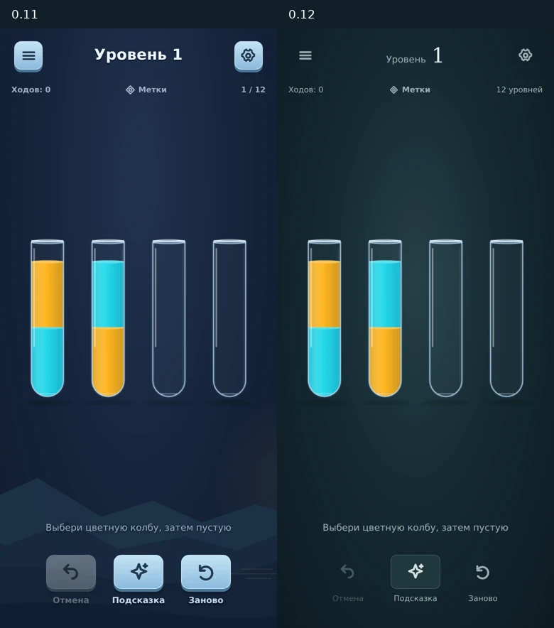
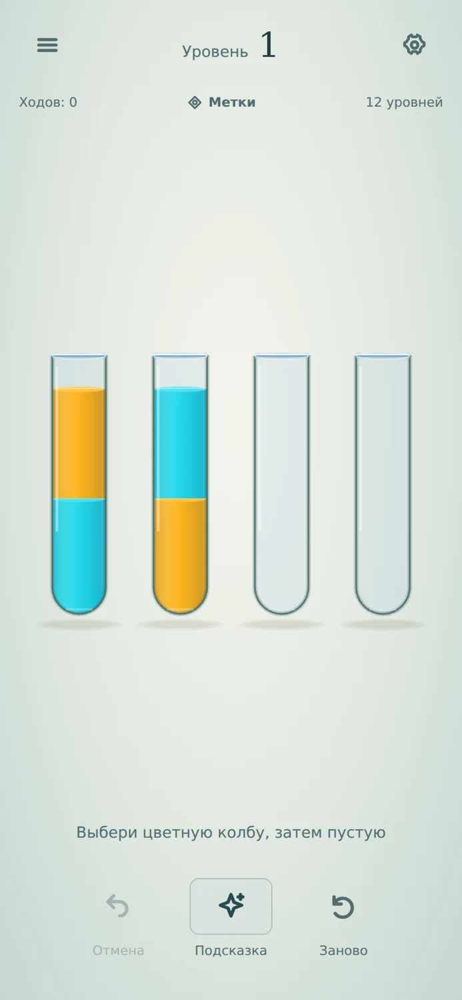
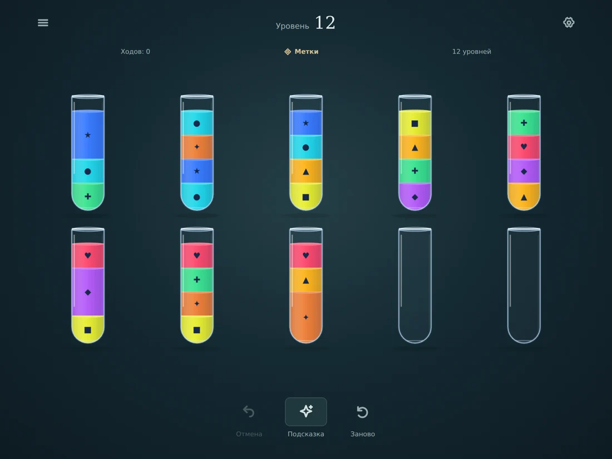
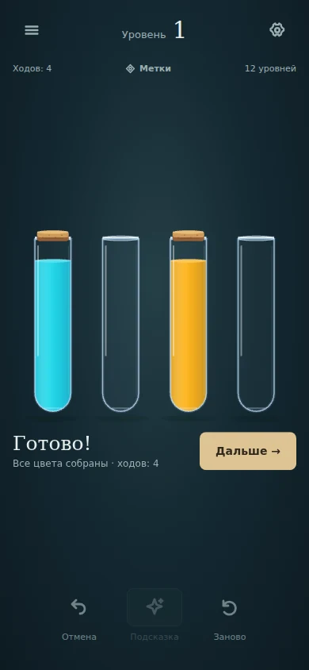

# Оформление и feel — 0.12

## Принятый план

1. Одна система оформления вокруг стекла и цветной воды: спокойное поле, лёгкие контроли, согласованные окна и две темы.
2. Убрать фон из зоны чтения колб; сохранить плотные поля, safe area и 48 px зоны нажатия.
3. Реакция поверхности на струю и отдельный финал уровня без увеличения времени хода.
4. Проверка обоих режимов, портрета/landscape, сохранений и прерываний; новый production-ролик и APK.

## Сделано

- Убраны пейзаж и луна из игрового экрана. Фон — единое мягкое освещение без объектов за прозрачными сосудами. Стеклянный контур в светлой теме стал темнее.
- Переписан CSS вместо добавления следующего слоя переопределений: единые цвета, контуры, размеры и состояния. Боковые и нижние вспомогательные действия облегчены; подсказка остаётся обозначенной, временная блокировка при переливании не превращает её в тёмную вспышку.
- Окна и выбор уровней используют те же материалы и типографику. Убрано повторяющееся «Закрыт» из каждой ячейки, доступность по-прежнему отражена семантическим названием и disabled. Метки названы последовательно в поле и настройках. Заголовок показывает текущий уровень, справа — размер набора без повтора номера.
- Блок результата поднимается в свободное место под колбами, не сдвигая поле и навигацию. Его позиция вычисляется из действующей раскладки, в том числе на плотных и маленьких полях.
- Во время потока волна рассчитывается от начала фазы течения, а не от времени, сбрасываемого каждым кадром. Движется верхняя поверхность, амплитуда ограничена глубиной слоя и высотой колбы. На остановке остаётся затухающая реакция.
- Финал использует отдельный блик с последовательным акцентом на всех собранных цветах. «Дальше» доступно сразу; смена уровня, Undo и прочие прерывания убирают незавершённый эффект.
- Звуки выбора/принятия/посадки сделаны тише относительно воды; файлы и временная привязка сохранены. Это выбранный баланс для проверки на телефоне, не результат субъективного прослушивания в этой среде.

## Проверка

Локально: 23 теста ядра, 59 браузерных, production build и cap sync проходят. Два новых сценария проверяют движение поверхности в реальном течении, спокойное состояние заблокированной подсказки, охват всех завершённых цветов финальным эффектом и немедленный переход дальше с отменой эффекта. Часы не подменяются.

Два визуальных прохода: по 30 кадров production-сборки на 9 размерах, обе темы, пустые/плотные поля, меню, настройки, подсказка и победа; pageerror отсутствуют. Повторный runtime-пробник подтвердил обработку отказа AudioContext, muted reload, hint и реальное добавление колбы. На 320×480 все 11 колб остаются в двух рядах, зона нажатия минимум 48×105.5.

После визуального просмотра финальная обводка изменена с прямоугольной рамки на контур сосуда. Production build и все 9 сценариев feel после этой правки прошли. Новый ролик снят уже с окончательным контуром: 7.69 с, 353 исходных CDP-кадра, захваченная дорожка Web Audio. Это запись браузера, а не измерение задержки динамика или кадровой частоты Android.

Материалы: `docs/audits/presentation-12/`.

Геометрия переливания, длительности фаз, уровни, схема сохранений и пакет preview3 сохранены. Физический телефон, вибрация, динамик и сравнительное прослушивание ещё не проверены. Это переработка представления существующей игры, без новой экономики, карты мира или расширения числа уровней.

## Android-сборка

CI run 40341733665 завершён успешно: 23 теста ядра, 59 браузерных, production build, cap sync и assembleDebug. Финальный игровой коммит: bc69c92bbcbda1dfd2452300820bc8e55fa83a49.

APK `watery-water-sort-0.12.0.apk`, 4 624 149 байт. SHA-256 `d13fed9682d2817e239a7fa6b18564ca9654e84405141d6cd4ab5d0ce57fe032`. Манифест: versionCode 12 / 0.12.0-presentation / com.danilah.waterywatersort.preview3. Сертификат совпадает с предыдущими preview-сборками; можно обновляться без удаления игры. ZIP цел, все файлы dist побайтно совпадают с assets/public; 11 OGG на месте. Главный bundle: index-BfmvAtTW.js.
