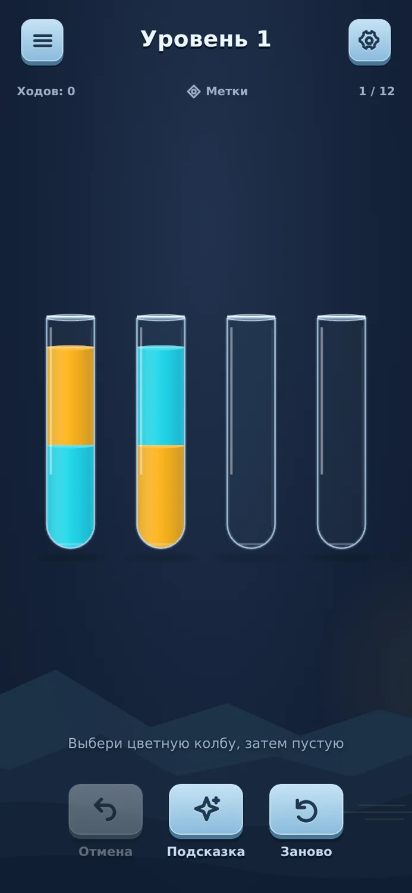
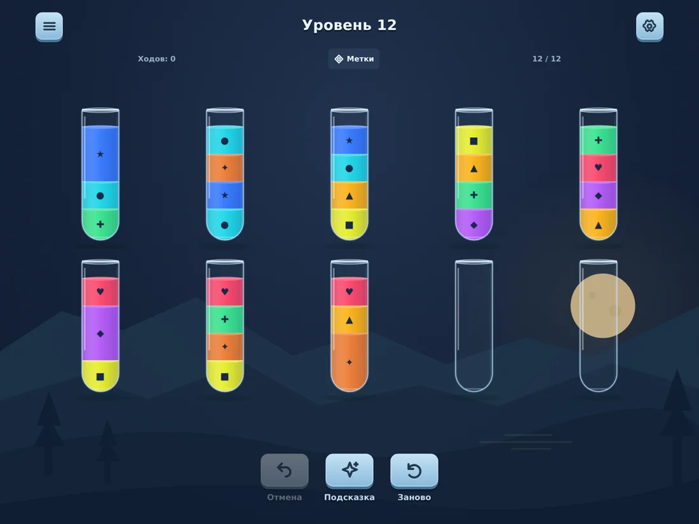
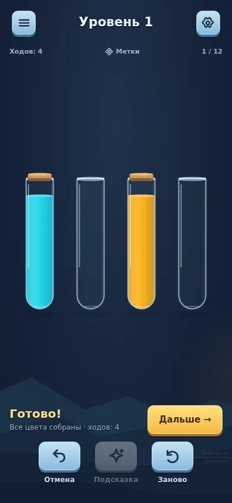
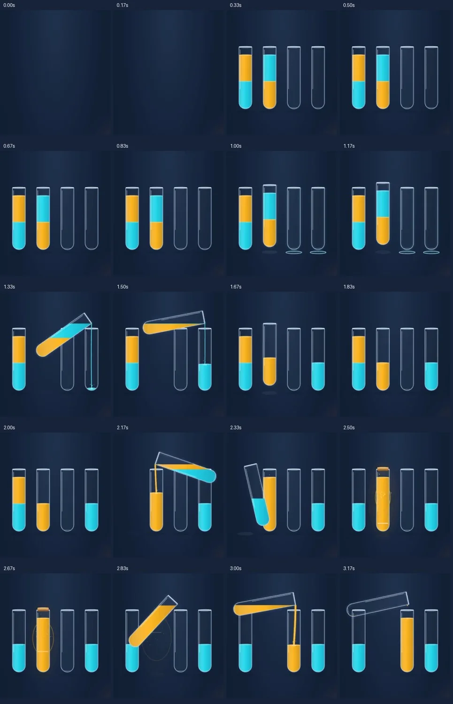
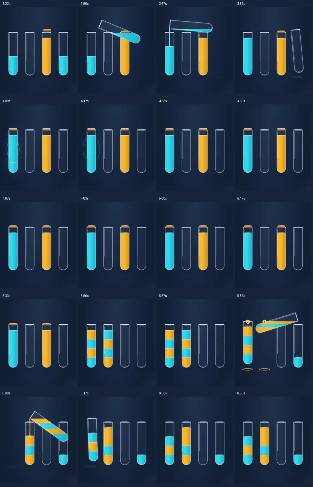
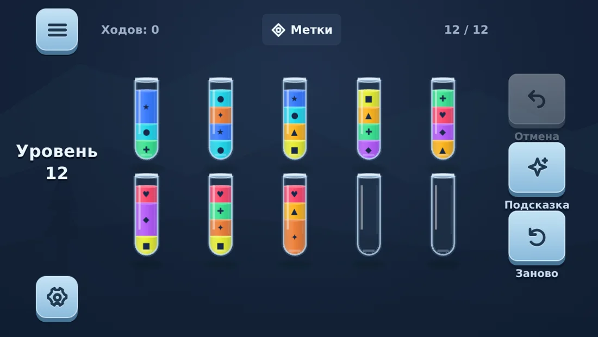
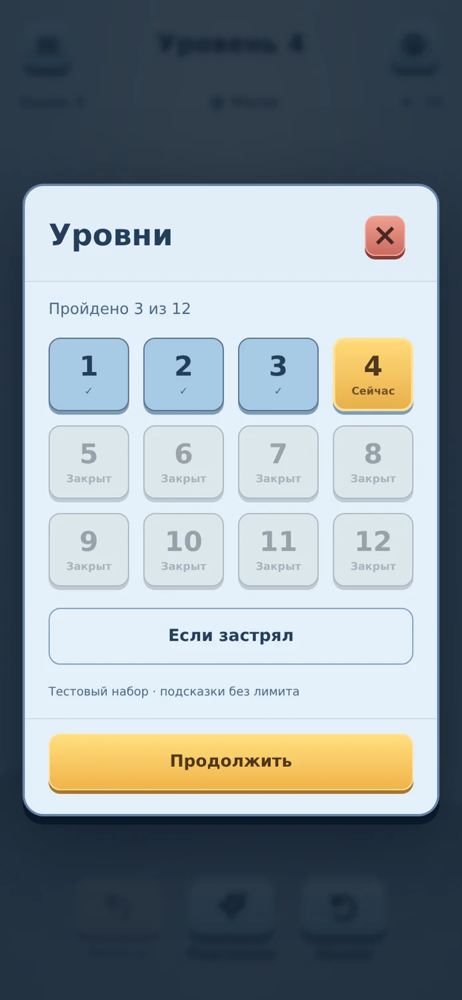

# Независимый визуальный разбор 0.11

26 октября 2026. Проверенная версия: f0d2a99 / production build 0.11. Новых игровых правок в этом проходе нет.

## Вердикт

У игры уже приличная основа переливания, но оформление всё ещё выглядит как аккуратный прототип из готовых деталей. Стекло и жидкость убедительнее, чем интерфейс вокруг них. Следующая заметная прибавка качества требует согласованного оформления поля, контролов и результата. Ещё одна порция частиц, градиентов и теней этого не заменит.

Сравнение с архивными видео 0.4–0.10 неприятно, но полезно: поведение стало лучше, а узнаваемый силуэт интерфейса почти тот же. Много наших итераций улучшали корректность и устойчивость, а не художественный характер. Проходящие тесты не подтверждают, что игра выглядит дорого или приятно звучит.

Это дизайнерская оценка наблюдаемых материалов, а не пользовательское исследование. Приведённые приоритеты относятся к впечатлению от продукта, не к критичности программных ошибок.

## Что действительно посмотрено

- Сняты и визуально проверены 30 свежих скриншотов production-версии: тёмная/светлая темы, 9 размеров от 320×480 до 1024×768, начальное/плотное поле, подсказка, меню, настройки, отмена и победа. Pageerror отсутствуют. Полная матрица — `audits/presentation-11/screens.json`.
- Записан новый ролик 0.11: 6.79 с, 343 исходных CDP-кадра, обычный ход, сбор цвета, перемещение уже собранного цвета, победа, быстрый режим и очередь. Разобран последовательными кадрами с временными отметками; монтажные листы ниже. Это настольный Chromium и реальный Web Audio bus, не запись телефона.
- Архивные ролики 0.4, 0.5, 0.6, 0.7, 0.8 и 0.10 просмотрены выборками кадров для сравнения эволюции. Полный непрерывный просмотр всех архивных роликов не заявляется.
- Прочитаны актуальные WaterScene, геометрия, DOM-интерфейс, CSS и звуковая схема. Старые выводы не использовались как доказательство текущих дефектов.
- Звук здесь не оценивался на слух. В ролике есть захваченный игровой микс, но наличие аудиодорожки и чтение кода не позволяют назвать тембр приятным, неприятным или утомляющим. Физические вибрация, динамик и touch latency не проверены.

## Что уже получилось

1. Цветные слои легко считать, стеклянная кромка и блик дают колбе объём. Само поле читается быстрее окружающего интерфейса.
2. Жидкость сохраняет горизонтальную поверхность при наклоне, выходит из горлышка, а объём убывает и прибывает согласованно. Это надо сохранить.
3. Выбор колбы имеет подъём; цель отмечена; следующее действие можно поставить в очередь. Отзывчивость не стоит жертвовать ради более длинных красивых анимаций.
4. Полный цвет отличается пробкой и локальным эффектом. Эффекты существуют: утверждение «их вообще нет» к этой версии неверно.
5. Кнопки имеют постоянные места; действие «Дальше» выделено золотым. Настройки и выбор уровня понятны без обучения.
6. Исправленное плотное поле с дополнительной колбой из 0.11 не требует очередной переделки механики или возврата к трём мелким рядам.

## 1. Нет цельного художественного решения — самый большой тормоз

На одном экране одновременно живут холодное гладкое стекло, кислотные цвета, толстые голубые кнопки с нижним бортиком, коричневая пробка, пейзаж с горами и золотые кнопки окон. Каждая деталь допустима отдельно. Вместе они выглядят скорее собранными из разных UI-наборов, чем специально нарисованными для «Переливов».

Проблема не в том, что градиенты или скругления запрещены. У колб и кнопок разная степень условности, материал и визуальный вес. Пейзаж не объясняет предметы и не создаёт для них убедительного пространства. Шрифт и одинаковая подчёркнутая объёмность всех кнопок добавляют ощущение универсального casual-шаблона.

**Направление:** сохранить стекло и цвет главным содержанием. Сделать окружающий интерфейс спокойнее: одна система контуров, теней, света и радиусов; менее выпуклые вторичные кнопки; более сдержанная типографика. Фон — мягкое пространство для колб, без случайных предметных акцентов за игровыми объектами. Не нужны лаборатория, новые персонажи, карта мира или магазин ради «характера».

## 2. Фон реально вмешивается в чтение колб

На 1024×768 яркий круг луны попадает за последнюю пустую колбу нижнего ряда. Прозрачность сохраняет силуэт луны внутри стекла. При беглом взгляде колба кажется содержащей посторонний жёлтый объект. Это уже конкретная ошибка композиции, а не вопрос вкуса. Меры для короткого landscape не покрывают планшетный экран.

В светлой теме горный контур проходит через нижний ряд; пустые колбы при этом и сами имеют слабый контраст. Материальный блеск читается хуже, чем в тёмной теме. Снижение общей непрозрачности фона помогает не во всех размерах.

**Что исправлять:** гарантировать спокойную область за всеми колбами во всех состояниях, включая дополнительную. Управлять композицией фона относительно поля, а не только относительно окна. Для светлой темы отдельно настроить кромку стекла и тень. Не закрашивать пустые колбы до непрозрачности: это скроет дефект, потеряв материал.

## 3. Победа слишком похожа на обычный ход

В новом ролике около 2.5 с собирается первый цвет: пробка, тонкий ореол, частицы и светлая полоска. Около 4.0 с завершается последний цвет. Локальная визуальная форма эффекта остаётся практически той же; после неё поле возвращается к той же статике. Отличие — текст и золотая кнопка внизу. В коде final увеличивает число частиц с 18 до 28, но сам Burst.final не используется для отдельной формы финального эффекта.

В результате завершение целого уровня выглядит как ещё одна заполненная колба. Результат расположен далеко от центрального действия; взгляд должен переместиться вниз. После затухания частиц экран победы на паузе почти ничем не отличается от обычного поля с закрытыми колбами.

**Что исправлять:** дать завершению уровня отдельную короткую композицию: согласованный блик по собранным колбам, ясный акцент результата ближе к полю, затем доступный «Дальше». Сохранить спокойный экран после акцента. Не добавлять обязательное ожидание, громкую полноэкранную вспышку, бесконечное конфетти, звёзды и придуманную экономику наград.

Сбор одного цвета должен оставаться коротким локальным материальным событием. Финал должен отличаться на видео без необходимости читать мелкий текст; это проверяемый визуальный критерий, а не доказательство роста удержания.

## 4. Вода всё ещё выглядит скорее шкалой заполнения, чем живой жидкостью

Геометрия стала правильной, и это ценно. Но поверхность принимающей колбы во время потока преимущественно ровная: она просто поднимается, а вокруг работают маленькие декоративные капли. В коде во время течения settles для получателя каждый кадр записывается текущим now; используемый для волны возраст становится нулём. Поэтому именно волна поверхности в этой фазе не развивается, хотя отдельные эллипсы и брызги рисуются.

После переливания колебания есть, но они мелкие и быстро затухают. На обычном масштабе внимание скорее замечает движение длинной колбы и тонкую прямую струю. Так возникает ощущение хорошо запрограммированной операции, а не особенно приятного контакта с водой.

**Что исправлять:** оживить место попадания струи и затухание поверхности. Согласовать амплитуду с поступающим объёмом и концом потока. Оставить короткий контакт при возвращении колбы и устойчивую точку остановки. Не растягивать ход и не возвращать резиновое сжатие стеклянного сосуда. Полная физическая симуляция жидкости не нужна.

## 5. Вспомогательные кнопки перетягивают внимание и мигают

Три нижние кнопки по размеру и объёму почти равнозначны. «Заново» — редкое действие с потерей текущей попытки — оформлено так же заметно, как «Подсказка». При каждом переливании подсказка становится disabled, а общее правило opacity=.4 резко её затемняет. После движения она снова яркая. На серии ходов получается повторяющаяся смена большого контрастного пятна вдали от струи.

Сама блокировка подсказки во время движения корректна; убирать её не требуется. Проблема в силе визуального перехода для очень краткого состояния.

**Что исправлять:** сохранить места и зоны нажатия, ослабить объём и визуальный приоритет вторичных действий; сделать временную недоступность подсказки спокойнее, чем полную недоступность отмены без истории. Не добавлять спиннер на каждый короткий ход. Главное подтверждение принятого действия должно оставаться у колбы.

## 6. Композиция работает технически, но ощущается пустой или служебной

На первых уровнях четыре колбы стоят в одном ряду среди большой площади однотонного фона. Само по себе свободное место не ошибка: пазлу нужно дыхание. Но сейчас оно почти не создаёт ни атмосферы, ни фокуса. Заголовок, повторный счётчик «1 / 12», «Ходов: 0» и «Метки» выглядят как служебная панель над демонстрацией механики.

Просто увеличить всё нельзя: четыре колбы в ряд ограничены шириной, а размер сосуда ограничен ещё и потолком 218 px в layout. Увеличение заголовков или заполнение пустоты карточками только усилит шаблонность.

На коротком landscape перенос заголовка в левую колонку спасает место, но «Уровень / 12» получает почти отдельный экранный сектор. Справа остаются три большие выпуклые кнопки. Игровое поле превращается в центральную панель между двумя тулбарами.

**Что исправлять:** отдельно подобрать композицию для малых стартовых полей и плотного пазла; в landscape сделать название уровня компактнее, а боковые контроли легче. Начать с масштаба, тонального фокуса и веса контролов, не с новых декоративных сущностей.

## 7. Меню и настройки понятны, но пока выглядят как универсальный компонент

Сетка уровней функциональна. Большая одинаковая выпуклая плитка для каждого номера, слово «Закрыт» в каждой недоступной ячейке и крупная рамка окна поддерживают тот же шаблонный визуальный язык. Техническая строка «Тестовый набор · подсказки без лимита» честна в preview, но в пользовательской версии её быть не должно.

Переключатель «Метки» на поле и «Символы на цветах» в настройках называют одно и то же по-разному. Уровень и номер набора сообщаются дважды. Это не серьёзные барьеры, но отнимают ясность в маленьком интерфейсе.

**Что исправлять:** привести окна к выбранной системе материалов; сократить повторяющиеся подписи и унифицировать названия. Не строить новую карту уровней, коллекции и сложный метапрогресс поверх банка из 12 уровней.

## 8. Звуковая схема заслуживает отдельного короткого сравнения

По коду обычное действие может включать select, accept, water и land, а завершение цвета добавляет cork и tonal complete. Accept, land и cork взяты из одной исходной записи закрывания стеклянного флакона; их различия ограничены сегментом, длительностью и уровнем. Три водяных варианта случайно чередуются; фильтр связан с заполнением.

Это описание устройства, не вывод «звучит плохо». Положительно то, что звук потока привязан к его оставшемуся времени и не должен запаздывать за законченной анимацией. Но ни 11 файлов, ни ограничение четырёх голосов не подтверждают разнообразия тембров и приятности сотого хода.

**Следующий разумный опыт:** на одной и той же короткой последовательности сравнить нынешний микс с версией, где вода и контакт главные, а отдельное UI-подтверждение принятия заметно тише. На реальном устройстве послушать обычный и быстрый режимы, серии ходов и финал. Нужна возможность честно отвергнуть вариант, а не заранее объявить его сочным. Новые синтезаторы, музыка и ещё десятки SFX пока не нужны.

## Что делать следующим проходом

| Порядок | Работа | Критерий результата |
|---|---|---|
| 1 | Утвердить одно оформление на реальном поле: основной портрет, светлая тема и landscape | Колбы, кнопки, окна и фон выглядят частью одной игры; решение видно по трём сопоставимым кадрам |
| 2 | Перенести эту систему в игру; убрать фон из зоны колб и облегчить контролы | Луна и силуэты не читаются как содержимое; 48 px зоны и плотные поля сохранены |
| 3 | Прицельно доработать реакцию жидкости и отдельный финал | В видео читаются поток, остановка, сбор цвета и завершение уровня; ход не стал длиннее |
| 4 | Сравнить два звуковых баланса на телефоне и повторно снять тот же ролик | Выбран приятный повторяемый вариант; нет позднего потока и навязчивого UI-стука |

Не рекомендую ещё один общий редизайн на основании длинного списка прилагательных. Нужен сначала конкретный согласованный вид действующего игрового экрана. Не следует одновременно менять механику, добавлять метаигру, писать новый рендерер и увеличивать число уровней ради этой задачи.

В реализации следующего оформления стоит собрать разросшийся CSS в единые правила. Сейчас разные этапы 0.7–0.11 переопределяют одни и те же размеры и цвета каскадом. Это объясняет стоимость дальнейшей полировки, но само по себе не повод для большого архитектурного рефакторинга.

## Что не считаю новым дефектом

Старую проблему запуска при отказе AudioContext, уязвимые версии зависимостей и уменьшение дополнительной колбы до трёх рядов не возвращаю в список: это исправлено в 0.11. Стандартные Android-иконка и splash остаются известной незакрытой работой перед публикацией; не выдаю их за открытие этого визуального прохода.

Готовность к магазину, оценка удержания, пригодность для всех нарушений цветового зрения и физический game feel этим просмотром не подтверждены. Количество отчётов и автоматических тестов не является критерием художественной готовности.
