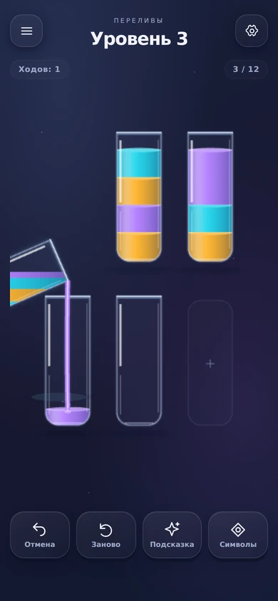
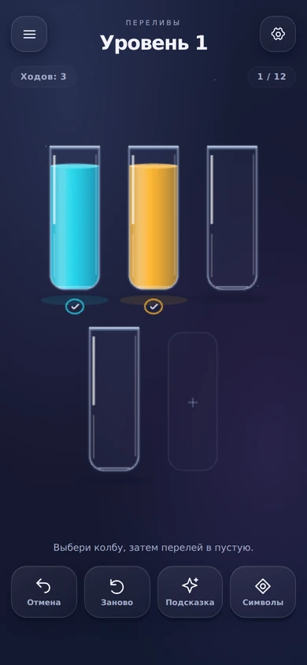
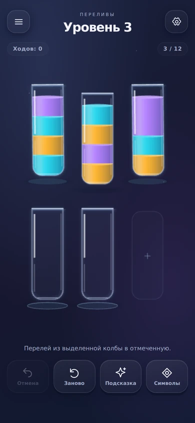
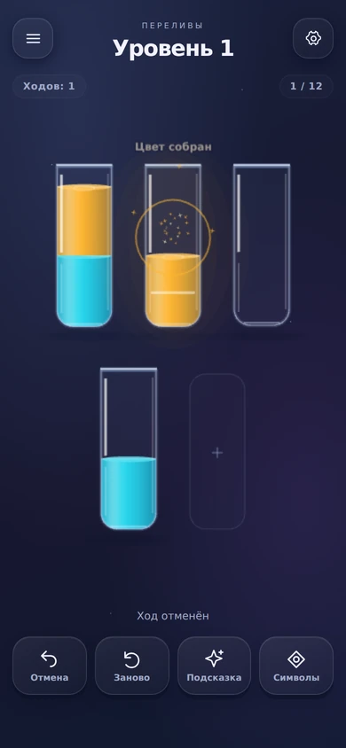
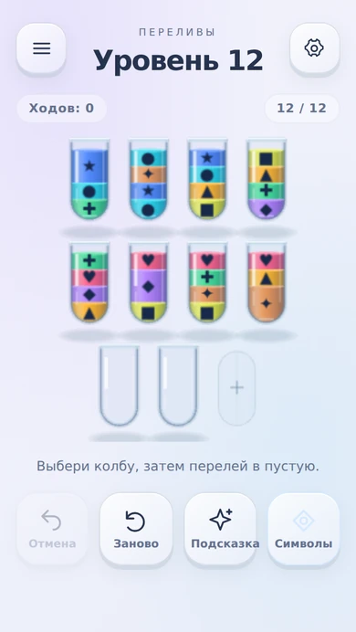
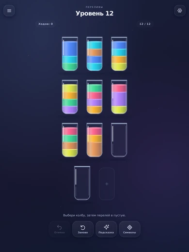
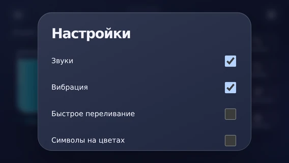

# UI/UX и feel — независимый проход версии 0.2

Дата: 24.10.2026, Asia/Yekaterinburg. Проверенный коммит: `14f208d7d443fb61280036b0c82b3806bdf1833a` («Переливы · тест», 0.2.0-feel).

## Вывод

0.2 уже даёт читаемый цикл «выбор → переливание → собранный цвет»: есть движение, материал жидкости, короткая награда, две темы и символы. Но ощущение законченной кэжуальной игры ещё не достигнуто. Главные причины — низкая плотность рендера, обрезание сосуда в некоторых переливаниях и неоднозначная связь визуальных сигналов с состоянием игры. Дополнительные частицы этих проблем не решат.

Приоритет следующей итерации: сначала шесть P1, затем согласованная подача материалов, управления и переходов. Расширять контент ради компенсации этих недостатков не нужно.

## Как проверялось и границы вывода

- Просмотрены текущие исходники представления, ввода, состояния, геометрии, звука и CSS. Это новый reviewer-проход, а не повтор заявления о выполненных улучшениях 0.2.
- 62 снимка состояний: 52 основной матрицы, 6 уточнений, 4 повторных снимка production bundle. Дополнительно просмотрены последовательные кадры из видеозаписи переливаний. Это не внешний человеческий плейтест.
- Размеры CSS viewport: 320×568, 360×640, 390×844, 568×320, 640×360, 844×390, 768×1024, 1024×768; дополнительно стресс 320×480. DPR 2 и 3. Светлая/тёмная темы, символы, меню и настройки.
- Сценарии: первый ход, выбор/ошибка/снятие выбора, подсказка и смена намерения, очередь, отмена во время награды, повтор, победа/просмотр поля/перезагрузка, изменение ориентации на последнем ходу, конец банка.
- Для поздних уровней использовались их реальные initialState. Такая установка позиции служит проверке компоновки; она не доказывает пригодность всей прогрессии. Завершённые позиции построены воспроизведением solutionWitness.
- Основная матрица шла через Vite для доступа к той же геометрии. Обрезание, подсказки, очередь, повторное открытие победы и маленькая альбомная модалка отдельно повторены на собранном production JS. В этих production-сценариях необработанных JS-ошибок не было.
- Физический Android, реальные safe insets, системный размер шрифта, TalkBack, задержка вибрации и прослушивание через динамик/наушники не проверялись. Численные параметры и события звука не заменяют слуховую оценку. FPS телефона не измерялся.
- В dev-видеозаписи виден первый неоформленный кадр. Он не объявлен дефектом APK: dev инжектирует CSS иначе, production подключает stylesheet из HTML.

[Машинные наблюдения](audits/2026-10-24/metrics.json). Иллюстрации ниже уменьшены для чтения; плотность canvas подтверждается исходными численными измерениями.

## P1 — исправить прежде дальнейшей полировки

### F01. Поле рисуется в 1× на экране с DPR 3

**Подтверждено измерением и визуально.** При CSS-размере 362×562 canvas имеет backing 362×562, хотя devicePixelRatio = 3. DOM-заголовки и кнопки при этом выводятся с плотностью браузера. Стекло, края жидкости и знаки в поле заметно мягче интерфейса. Этот дефект напрямую влияет на впечатление от всей графики.

**Улучшение:** ввести управляемую плотность рендера с сохранением логических координат и hitbox; проверить варианты 1.5×/2× на минимальном устройстве. Отдельно учесть разрешение текстовых текстур Phaser. Безусловный DPR 3 не назначать без оценки памяти и времени кадра.

**Приёмка:** сравнительные кадры DPR 1/2/3; резкость поля сопоставима с DOM; цели нажатия совпадают с изображением; поворот не меняет масштаб; зафиксирован бюджет на физическом устройстве.

### F02. Во время переливания сосуд уходит за левую границу

**Подтверждено на production.** Уровень 3: выбрать колбу 0, перелить в пустую колбу 3 под ней. Во время наклона значительная часть источника оказывается за пределами canvas и отсекается. Совпадение X выбирает один фиксированный знак наклона; свободное место для корпуса не проверяется.

**Улучшение:** выбирать сторону наклона по доступному месту; учитывать весь повёрнутый силуэт и дугу, а не только положение носика. При необходимости ограничивать высоту/угол или смещать временную позу. Разрешать переливание с любой стороны поля без пролёта через кнопки.

**Приёмка:** все пары законных источников/целей на используемых компоновках прогнаны по промежуточным кадрам. Ни корпус, ни блик, ни струя не обрезаются. Траектория остаётся быстрой и непрерывной.

### F03. После возвращения к собранной позиции пропадает очевидный переход дальше

**Подтверждено двумя способами.** Пройти уровень 1 → «Посмотреть поле» → перезагрузить. Получается собранное поле и инструкция «Выбери колбу, затем перелей в пустую», кнопки «Дальше» нет. Доступ к переходу спрятан в подсказке или меню. Изменение viewport во время последнего хода также оставляет сохранённую победу без окна и с пустым статусом.

**Причина:** завершённость сохранена до анимации, но показ следующего действия зависит от onComplete/таймера, которые отменяются при interrupt.

**Улучшение:** выводить доступность «Дальше» из сохранённого won-state при старте, Resume, повороте и после закрытия окна. Праздник может быть пропущен, действие продолжения должно оставаться доступным.

**Приёмка:** reload/поворот/прерывание последнего хода/«Посмотреть поле» всегда дают явное продолжение. Повторный запуск победной анимации не обязателен; завершение и доступ следующего уровня не удваиваются.

### F04. Подсказка показывает выбор, которого фактически нет, и конфликтует с ручным выбором

**Подтверждено на production.** На уровне 3 подсказка поднимает источник 2 и отмечает цель 4. Нажатие только на цель не делает ход: счётчик остаётся 0, потому selected всё ещё null. Затем выбор другой полной колбы 0 оставляет старый hintMove: две колбы выглядят источниками, остаются старые/новые цели и инструкция про «выделенную» колбу.

**Улучшение:** выбрать единую семантику. Практичный вариант — при показе совета действительно выбрать его источник, не исполняя ход автоматически; ручной выбор другого источника отменяет подсветку совета. Альтернатива — отдельный пошаговый визуал «сначала источник», который нельзя спутать с выбранным сосудом. У источника и цели должны быть различимые сигналы, а не похожие ореолы.

**Приёмка:** один источник действия, одна ясная целевая подсказка; совет не спорит с ручным вводом; повтор/отмена/тап по фону не оставляют устаревшие маркеры.

### F05. Отмена хода оставляет ложное празднование собранного цвета

**Подтверждено снимком.** Сделать первые два хода уровня 1 и сразу нажать Undo. На поле уже восстановлена неполная колба, но над ней продолжаются «Цвет собран», световой проход и искры. interrupt останавливает переливание, однако не очищает bursts/particles/floatLabels.

**Улучшение:** привязать одноразовые эффекты к revision и отменять их при откате, повторе и смене задачи. Сам Undo может иметь собственный короткий обратный отклик, но не награду предыдущей позиции.

**Приёмка:** Undo в каждый момент после завершения цвета/победы оставляет визуальную правду. Не остаётся надписей, галочек и звуков от отменённого результата.

### F06. На коротком альбомном экране соседние области нажатия пересекаются

**Подтверждено геометрией и кодом ввода.** Для 11 мест на 568×320 расстояние центров соседних колб ≈44.86 CSS px. Минимальная ширина hitbox — 48 px; пересечение ≈3.14 px. findIndex отдаёт общую область первой колбе. На стресс-экране 320×480 шаг ≈47.33 px, пересечение меньше, но также есть. Количество ошибочных тапов живых людей не измерялось.

**Улучшение:** развязать горизонтальную ширину целей и вертикальный размер сосудов. Сейчас общий scale уменьшает всё поле при дефиците высоты, хотя ширина ещё есть. Сначала переразложить ряды/компактный HUD, затем проверять эксклюзивную область каждой колбы. Не убирать баннерный резерв без отдельной политики его состояния.

**Приёмка:** для каждой колбы есть непересекающаяся удобная область не менее проектного минимума; тесты проверяют не только размер max(48, …), но и расстояния между соседними целями. Крайние колбы равноправны центральным.

## P2 — оформление и ощущение хода

### F07. Тень приклеена к движущемуся сосуду

**Код и кадры.** Эллипс рисуется от r.y+h, поэтому поднимается и летит вместе с колбой. Это ослабляет ощущение отрыва от поверхности; в некоторых кадрах тень выглядит как лишнее кольцо в воздухе.

**Изменить:** держать контактную тень у исходной опоры, уменьшать/смягчать её при подъёме; для движущегося сосуда использовать отдельную слабую проекцию. Возвращение подчёркивать контактом, а не только деформацией корпуса.

### F08. «Волна» почти не деформирует массу жидкости

**По коду.** Основной заполненный полигон и эллипс поверхности остаются ровными; колеблется тонкая линия поверх них. Принимающая колба оживает слабее, чем её световые эффекты.

**Изменить:** связать небольшой профиль поверхности и затухающую рябь с попаданием струи/посадкой. Геометрия состояния остаётся прежней, меняется только представление. Достаточны 1–2 заметных затухающих движения, полноценная физика не нужна.

### F09. Перенос одной и нескольких единиц почти одинаково подаётся

**По коду.** Ширины струи фиксированы; длительность одинакова внутри выбранного режима; amount слабо меняет громкость. Количество переданной жидкости видно по уровню, но не очень ощущается в самом действии.

**Изменить:** немного варьировать толщину струи, силу ряби и огибающую звука по объёму. Сохранить короткий бюджет, не умножать длительность на q. Большой перелив должен быть плотнее, а не просто длиннее.

### F10. Активная кнопка символов теряется в светлой теме

**Подтверждено стилями и снимком.** Включённая кнопка наследует цвет иконки rgb(212,234,255), почти белый на почти белом фоне. Включённое состояние местами менее заметно, чем обычное. Общая низкая контрастность пустого стекла/плюса в светлой теме также требует настройки.

**Изменить:** полноценные отдельные токены для активного состояния светлой темы — тёмная иконка, видимая заливка/бордер, различимость без зависимости от лёгкого свечения. Проверить и уменьшенную яркость телефона.

### F11. Нижняя панель не отражает важность действий

**Визуальная оценка.** Undo, Restart, Hint и Symbols выглядят почти равными по весу. Частая безопасная отмена стоит рядом с разрушительным повтором, а вспомогательная настройка получает столько же площади, сколько помощь.

**Изменить:** сделать отмену удобным основным инструментом, подсказку — различимой помощью, повтор — спокойнее и с подтверждением; символы оставить доступными с поля, но оформить компактным вторичным переключателем. Сохранить достаточные цели, не просто уменьшить подписи.

### F12. Меню и настройки оформлены слабее игрового поля

**Снимки.** Колбы уже имеют свой материал, а настройки остаются обычным списком браузерных checkbox. Меню выглядит как панель с примечанием о сборке; текущий уровень не имеет отдельного маркера, закрытые уровни обозначены в основном общей прозрачностью.

**Изменить:** единый компонент переключателя, одинаковые отступы и группировка. В каталоге различать текущий/доступный/пройденный/закрытый уровни. Техническую заметку о прототипе подчинить действию «Продолжить», а не делать главным содержимым.

### F13. Планшетная компоновка неоправданно узкая и вытянутая

**Снимок и геометрия.** На 768×1024 поле шириной 740 px использует шаг 100 px и четыре ряда 3+3+3+2. Ширина видимой колбы остаётся 62 px. Ограничение size ≤100 и выбор первого одинакового максимума мешают осмысленно использовать большой экран.

**Изменить:** оценивать компоновку по числу рядов, размеру жидкости, расстояниям и свободному месту вокруг движения. При равном размере предпочитать более компактную сцену; адаптировать максимум под экран. Просто растянуть весь HUD не нужно.

### F14. У модальных окон в коротком альбоме пропадает видимое закрытие

**Подтверждено на production.** На 568×320 у настроек clientHeight 270, scrollHeight 411; кнопка «Готово» начинается около y=359 и не видна. Прокрутка работает и позволяет до неё добраться, но её необходимость плохо обозначена. Это не недоступная навсегда кнопка, а лишнее трение.

**Изменить:** закрепить видимое закрытие/заголовок, прокручивать только содержимое, уплотнить строки или использовать две колонки в широком низком окне. Проверить все действия без авто-прокрутки тестового фреймворка.

### F15. Между уровнями и при повторе поле появляется слишком резко

**По коду и кадрам.** Смена состояния сразу меняет геометрию и содержимое. CSS-анимация окна не заменяет переход самой игровой сцены. Undo останавливает активный перелив и моментально пересобирает поле.

**Изменить:** короткий единый язык переходов: уход завершённого поля → появление нового, мягкая посадка колб; для Undo — небольшой обратный визуальный отклик или согласованный snap с импульсом. Сохранение не ждать до конца эффекта. Цель — убрать «перерисовку программы», не задержать игрока.

### F16. Первые действия обучаются одной слишком общей фразой

**Подтверждено.** Стартовый текст предлагает пустую колбу, но почти не объясняет совпадение верхнего цвета, вместимость и перенос всей верхней группы. Тот же стартовый текст появляется при восстановлении других позиций. Нет явного перехода от первого успешного действия к следующему правилу.

**Изменить:** 2–3 контекстных коротких шага на первых задачах. После выбора — понятная цель; после удачного перелива — совпадение цвета; после отказа — конкретная причина, если она однозначна. Не добавлять длинные обязательные карточки.

### F17. Количество жидкости и символы нуждаются в отдельной настройке для маленьких колб

**Снимки и код.** Одноцветные единицы объединяются в сплошную полосу без делений; их число приходится оценивать по высоте. Знаки имеют фиксированные 15 px даже при высоте сосуда около 60–72 px. На малых слоях знак занимает слишком большую часть жидкости.

**Изменить:** очень тихие деления/метки ёмкости и адаптивный размер символов. Сохранить один знак на непрерывную группу, если так чище; единицы должны читаться по высоте/меткам. Не превращать колбу в клетчатую таблицу.

### F18. Неактивная дополнительная колба выглядит как приглашение к действию

**Подтверждено.** Плюс занимает постоянное место на поле, по тапу открывает объяснение недоступной рекламы. Игрок получает прерывание вместо помощи. Недоступность функции в прототипе известна и сама по себе здесь не считается ошибкой монетизации.

**Изменить:** показать её состояние понятнее и снизить вероятность случайного модального прерывания. При реальном подключении помощи явно обозначить награду/доступность. Геометрический резерв сохранить.

### F19. Тап по фону снимает выбор, но не отменяет отложенный ход

**Подтверждено на production.** На уровне 1: принять ход 1→3; пока он анимируется, выбрать 0→2; тапнуть по фону. До тапа счётчик 1, после завершения анимаций — 2. queued не очищается этим тапом. Намерение подсвечивается, поэтому это не полностью невидимый ход, но семантика «отменить выбор» неоднозначна.

**Изменить:** решить явное правило отмены очереди. Практичный вариант — тап по фону очищает выбранный источник и отложенное намерение; смена источника заменяет/отменяет очередь согласованно. Не накапливать скрытые действия и не убирать возможность быстрого следующего хода.

## P2 — художественная цель и ритм награды

### F20. У игры ещё не сформирован цельный визуальный образ

**Художественная оценка, не технический дефект.** Тёмный сине-фиолетовый градиент, объёмные панели и стекло существуют рядом, но сцена ощущается скорее аккуратной инструментальной панелью. Узкие яркие вертикальные блики местами делают жидкость похожей на полированный цилиндр. Звёзды/ореолы добавляют общую «магию», но не усиливают тему переливания.

**Направление:** оформить спокойную сцену стеклянных сосудов и цветной жидкости. Нейтральный фон, более естественное бесцветное стекло, доминирование насыщенной жидкости, мягкая опора и меньше декоративного интерфейсного блеска. Для светлой темы стоит сравнить текущую холодную подложку с тёплой нейтральной; для тёмной — отделить стекло от фона без широких фиолетовых пятен. Сначала один законченный игровой экран и его проверка, потом распространение на меню. Отдельная иллюстрация/мета-карта не нужны.

### F21. Награда за цвет слишком универсальна и слабо связана с водой

**Визуальная оценка и код.** Кольцо, звёзды, горизонтальный световой проход и одинаковая надпись работают как отметка, но почти не отличаются по смыслу от эффекта получения любого предмета. На сложном поле повтор текста может конкурировать с самими слоями.

**Изменить:** поставить первым ясный локальный результат — собранный цвет становится спокойным, чистым и завершённым. Усилить короткую посадку/мениск/стеклянный акцент, оставить несколько осмысленных бликов или капель. Общую подпись показывать в обучении или при редком событии. Лёгкий рост тона между собранными цветами можно проверить, но без назойливой лестницы и долгих фанфар.

### F22. Окно победы и общий праздник требуют общего сценария

**Снимки и код.** Окно появляется через 120 мс после завершения перелива, при эффектах длиной 650 мс. Оно может закрывать часть многорядного результата; автоматическая фокусная рамка делает основную кнопку похожей на элемент формы. В первом уровне верхние собранные колбы остаются видны — не весь праздник перекрыт.

**Изменить:** разместить компактное продолжение так, чтобы завершённая раскладка читалась; дать короткую паузу увидеть последний цвет, сохранив заданный бюджет доступности «Дальше». Оставить клавиатурный фокус различимым, но отделить его от лишней рамки на touch-сценарии. После закрытия панели доступ к следующему уровню должен сохраняться (F03).

## P3 — измерить и уточнить после P1/P2

### F23. Аудио требует единой политики отклика и мягкого прерывания

**Только по коду/параметрам.** Синхронизация основной струи рассчитана последовательно: 560×0.48≈269 мс и 320×0.48≈154 мс совпадают с запрашиваемыми отрезками звука. Варианты не повторяются подряд, голоса ограничены. Но stop() обрывает источники немедленно; не все кнопки навигации имеют собственный звуковой отклик; вызов до окончания decode просто остаётся без звука.

**Проверить:** короткий fade при отмене/приглушении, готовность первого звука на медленном устройстве, согласованные тихие UI-акценты и отчётливую иерархию «тап < поток < цвет < победа». Это риски реализации, а не доказанные щелчки или плохой звук динамика. Нужен повторяемый телефонный тест минимум 20 минут, включая фон/Resume и внешнюю музыку.

### F24. Бесконечная анимация выбранного сосуда требует проверки пользы и стоимости

**По коду.** Пока источник выбран или есть hintMove, он постоянно покачивается, цели пульсируют и представление продолжает обновляться. Отдельного режима сниженного рендера неподвижной сцены не настроено. Реальный нагрев и FPS этим не установлены.

**Проверить:** затухающий подъём с устойчивым состоянием для обдумывания; более живое движение только при активном действии/подсказке. Сравнить стоимость кадра на позднем поле, просто выбранной колбе и неподвижном поле. Частоту/плотность рендера настраивать по измерениям, не ценой потери мгновенного тапа.

## Что получилось и что сохранять

- Верхние группы и направление перелива читаются; жидкость не привязана к покадровому изменению игровой логики.
- Отклик выбора, реальная вода в звуковом наборе, отдельное завершение цвета и победы дают хорошую основу для полировки.
- Бесплатный Undo и повтор той же задачи поддерживают экспериментирование. Подтверждение повтора понятно по смыслу.
- Две темы и символы уже доступны без перезапуска уровня; это полезнее дополнительной декоративной меты.
- Обычное поле и основные кнопки в проверенной матрице не выходят за DOM-viewport. Проблемы — конкретные траектории, плотность и цели, а не тотально сломанная адаптивность.
- Длинный текст подсказки на 320×568 в проверенном случае занимает 36 px и помещается в отведённую область; предположение об обязательном налезании на кнопки не подтвердилось.
- Прокрутка короткой альбомной модалки работает; её нельзя описывать как безвозвратную блокировку.

## Рекомендуемый порядок следующего прогона

1. **Правда состояния:** F03/F04/F05/F19 — продолжение победы, единственная ясная подсказка, отмена эффектов и очередь.
2. **Чёткость и геометрия:** F01/F02/F06/F13 — плотность, безопасная траектория, раздельное масштабирование целей/сосуда и планшетная сцена.
3. **Оформление:** F10/F11/F12/F14/F17/F18/F20 — контраст, иерархия, меню/настройки, читаемость и один художественный ориентир.
4. **Цельный ход:** F07/F08/F09/F15/F16/F21/F22 — вес, поверхность, объём, переходы, обучение и законченная награда.
5. **Телефонная приёмка:** F23/F24 и фактические p95/FPS/звук/вибрация. Условия и устройство записать; красивый скриншот не закрывает feel.

Не добавлять новые режимы, магазин, крафт, карту и ещё 100 эффектов до этого прохода. Формат исправлений — один связный цикл действия и перехода, затем повтор тех же сценариев и новый APK для сравнения с 0.2.

## Привязка к исходникам

- [main.ts](https://github.com/DanilaH/watery-water-sort/blob/14f208d7d443fb61280036b0c82b3806bdf1833a/src/main.ts): interrupt, victory/onComplete, scene.onTap, hint handler, меню/настройки.
- [WaterScene.ts](https://github.com/DanilaH/watery-water-sort/blob/14f208d7d443fb61280036b0c82b3806bdf1833a/src/game/WaterScene.ts): траектория, hit testing, материалы, волна, эффекты и непрерывная анимация.
- [geometry.ts](https://github.com/DanilaH/watery-water-sort/blob/14f208d7d443fb61280036b0c82b3806bdf1833a/src/game/geometry.ts): единый size для X/Y, cap 100, выбор первой равной компоновки.
- [style.css](https://github.com/DanilaH/watery-water-sort/blob/14f208d7d443fb61280036b0c82b3806bdf1833a/src/style.css): активные состояния, модалки, темы, панель действий.
- [sound.ts](https://github.com/DanilaH/watery-water-sort/blob/14f208d7d443fb61280036b0c82b3806bdf1833a/src/audio/sound.ts): загрузка, огибающие, остановка и лимит голосов.
