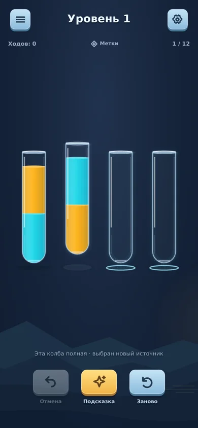

# Повторный UI/UX/feel-разбор 0.5 и сравнение с конкурентами

24 октября 2026. Проверена версия `2a4b04e3c6b76eba9aec40d05325b76c16c840f5`. Результат этой работы — аудит, игровой код не менялся.

## Вывод

В 0.5 есть достаточно цельное визуальное направление и исправленная связь жидкости со струёй. Следующая полезная итерация — предсказуемый быстрый ввод и согласованный отклик. Повторная смена палитры, усложнение стекла, дополнительные сундуки или увеличение фейерверков не обоснованы этим прогоном.

Подтверждены: игнорирование допустимого следующего хода через занятую текущей анимацией колбу; одновременные сигналы ошибки и успешного выбора при смене источника; отсутствие самостоятельного сообщения о полном отсутствии допустимых ходов. Обнаружена также лишняя просьба подтвердить повтор до первого хода. Скорость 560ms сама по себе не объявляется дефектом: ускоренный режим уже есть, а восприятие темпа зависит от предсказуемости ввода.

## Метод и пределы

- Свежий прогон работающего Vite-приложения: быстрые связанные ходы, независимая очередь, переключение источника, подсказка, победа, Undo после победы, повтор до первого хода и достижимый тупик. [Журнал](audits/review-05/interactions.json).
- Воспроизводимый интерактивный прогон: `node --import tsx tools/audit-ux-05.mjs http://127.0.0.1:4175` против Vite dev server. Сценарий тупика отдельно воспроизводится сохранением из отчёта.
- Журнал содержит вызовы звуковых событий, а не запись акустического выхода. Отсутствие JS-ошибок проверено.
- Для основных сценариев использован реальный ход времени. Промежуточный эксперимент с часами браузера дал ненадёжное продвижение анимации в части последовательно создаваемых контекстов; его выводы о победе отброшены, сценарии повторены без подмены времени. Сохранён итог повторного прогона.
- Дополнительно просмотрены текущие код, рендер, снимки 0.5 на маленьких экранах/планшете и точные кадры перелива из `FLOW_AND_UX_05.md`.
- Сравнены магазинные изображения и доступные отзывы Vnstart, Guru, Fantasy Games, SortPuz и Magic Sort. Эти приложения не устанавливались. Магазинные композиции не считаются измерением реальной плотности поля, таймингов или всех меню.
- Звук на динамике/в наушниках, физическая вибрация, FPS/нагрев Android и утомление от длинной сессии не оценены. Числа аудиофайлов и код не доказывают приятность звучания.

## Сравнение практик

| Аспект | Наблюдение у конкурентов | Состояние у нас / решение |
|---|---|---|
| Читаемость | У Vnstart и Guru простые контрастные силуэты, отдельные слои и тёмная основа [1,2] | Сопоставимый принцип реализован. На маленьком экране 0.5 колбы укрупнены. Не усложнять стекло ради количества бликов |
| Состояние собранного цвета | На изображениях Fantasy есть пробка у завершённой пробирки [3] | Наши пробки дают различимое состояние; победа не закрывает поле. Больше частиц не требуется по результатам проверки |
| Темп | В отзыве Guru от 12.09.2026 просят ускорить анимацию. В старом отзыве Vnstart от 01.10.2021 хвалят несколько одновременных переливаний [1,2] | Это свидетельства ожиданий авторов, не замер текущих версий. У нас 560ms/320ms, но главный подтверждённый барьер — непоследовательная очередь |
| Свободное исправление | Fantasy заявляет повтор текущего уровня. В отзыве SortPuz жалуются на дорогую отмену и потерю старых возможностей [3,4] | В прототипе бесплатны Undo и тот же повтор; историю/прогресс не теряем. Сохранить эти свойства. Полный рекламный UX ещё не реализован и конкурентным преимуществом не объявляется |
| Иерархия помощи | У Vnstart помощь компактна, дополнительная колба выделена цветом [1] | У нас подсказка — самый яркий нижний инструмент. Снижение её визуального веса — допустимый A/B-эксперимент, не обязательный фикс |
| Тематическая мета | Magic Sort показывает персонажей/события и отдельные предметные бутылки [5] | Большая стоимость производства. Не переносить метаигру ради косметического ощущения «богаче» |
| Аудио | Guru и SortPuz рекламируют ASMR/звук воды [2,4] | Рекламное обещание не доказывает лучший звук. У нас записи воды, три варианта струи, fade и разные события; нужен сравнительный телефонный сеанс, прежде чем менять банк |

## Подтверждённые находки

### R01 — P1: следующий допустимый ход может молча потеряться

Уровень 1: `0→2`, во время анимации `1→0` (индексы с нуля). Второй ход допустим для уже принятой доски, но тап по `0` игнорируется из-за `busyTube(i)`. После окончания переливания история содержит один ход, источник `1` остаётся выбранным, явного отказа или очереди нет.

Контроль: `1→3`, затем `0→2` во время первой анимации — независимая очередь принимает второй ход и исполняет его. Пользователь не видит, почему одинаковая последовательность из двух тапов иногда работает заранее, а иногда требует повторить тап.

Рекомендация: принимать одно следующее намерение по принятому состоянию доски, включая занятые колбы, с понятной визуализацией очереди. Если часть ввода нельзя принять, давать короткий явный отклик. Не вводить сложную многокомандную очередь или полноценный параллелизм без необходимости.

### R02 — P2: переключение источника сопровождается ошибкой

Уровень 1: выбрать `0`, затем полную несовместимую `1`. Игра трясёт `1`, вызывает `reject()`, сразу выбирает её новым источником и вызывает `tap()` с haptic. Между двумя вызовами звуковых событий в живом прогоне около 0.1ms. Надпись: «Эта колба полная · выбран новый источник».

Проблема — два противоположных смысла на одном действии. Сама возможность сменить источник полезна. Рекомендация: сделать выбор другого источника нейтральным переключением; настоящий отказ показывать без одновременного сигнала успешного действия.

### R03 — P2: достижимый тупик никак не отмечен до запроса подсказки

На уровне 7 найдена корректная позиция после семи легальных ходов с нулём допустимых ходов. Сохранение проходит `validSave()`. На открытом поле `status` пуст. По нажатию подсказки решатель сообщает: «Из этого положения решения нет. Можно отменить ходы». Undo доступен.

[Воспроизводимое сохранение](audits/review-05/deadend-save.json), [результат](audits/review-05/deadend-result.json).

Рекомендация: при `moves(board).length===0` показывать ненавязчивое предложение отмены. Не завершать уровень принудительным проигрышем, не требовать рекламу, не запускать дорогой полный решатель после каждого хода. Позиции с доступными, но бесперспективными ходами — отдельный случай; их нельзя объявлять тупиком по этому дешёвому критерию.

### R04 — P3: подтверждение повтора без потерянного прогресса

До первого хода «Заново» уже требует подтверждения. Можно повторять без диалога, если изменений ещё нет; подтверждение оставлять при потере реальных ходов. Небольшая правка, не причина переделывать меню.

## Что проверено и стоит сохранить

- Подсказка выбирает реальный источник, цель имеет отдельную стрелку. Ручное продолжение понятно.
- Победа в живом прогоне: три хода, состояние собрано, «Дальше» видна. Undo уменьшает историю до двух ходов и убирает продолжение; новой награды не выдаётся.
- Данные текущего этапа и настройки остаются источником состояния; не нужна дополнительная анимационная копия прогресса.
- 200 известных достижимых witness-префиксов сложных уровней решены на Node-хосте: 200 FOUND, 0 UNKNOWN, p95 около 1.12ms, максимум около 4.98ms. Это не измерение телефона и не гарантия решения любых пользовательских позиций.
- Символы доступны с поля. Упрощение/снижение их доступности ради чистого вида не предлагается.
- Времена обычного/быстрого переливания — 560/320ms; фаза струи 269/154ms. У всех объёмов одна длительность режима. Проверять более быстрый default или зависимость от объёма стоит после R01, отдельным сравнением одинаковой задачи.

## Следующий ограниченный прогон

1. Исправить R01 и проверить цепочки, замену/отмену очереди, Undo и последний ход.
2. Устранить противоречивый отклик R02.
3. Добавить мягкое сообщение для R03; R04 можно включить как небольшую сопутствующую правку.
4. На той же сцене сравнить обычный/быстрый темп и звук на физическом телефоне. Не расширять банк, графику или мету до этой оценки.

## Источники

1. [Vnstart — Water Color Sort](https://play.google.com/store/apps/details?id=com.vnstartllc.sort.water&hl=en). Старый отзыв о параллельных переливах не считается проверкой текущей сборки.
2. [Guru — Water Sort Puzzle](https://play.google.com/store/apps/details?id=water.sort.puzzle.game.color.sorting.free&hl=en). Отзыв Winter от 12.09.2026, магазинные изображения и описание.
3. [Fantasy Games — Water Sort](https://play.google.com/store/apps/details?id=water.sort.puzzle.wood.color.sort.brain.train.test.watersort.ball.sort.logic.game&hl=en).
4. [Dark Halo — SortPuz](https://play.google.com/store/apps/details?id=sortpuz.water.sort.puzzle.game&hl=en). Отзывы — опыт конкретных авторов, не доказанная массовость или намеренная непроходимость.
5. [Grand Games — Magic Sort](https://play.google.com/store/apps/details?id=com.grandgames.magicsort&hl=en).
